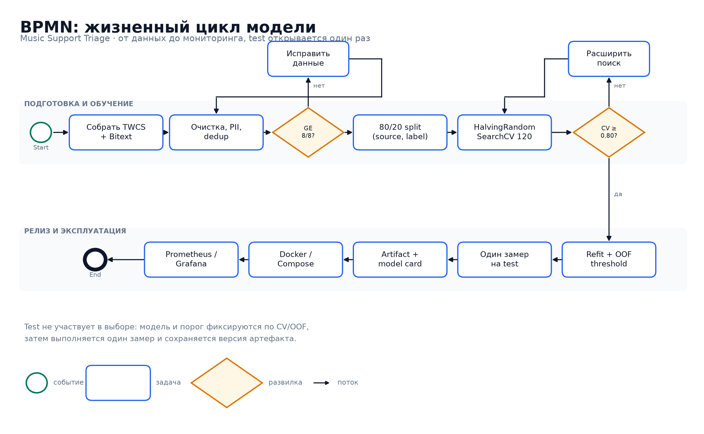

# Model card: selected pipeline

**Версия:** `search-logreg_word-20261114200534`  
**Дата:** 14.11.2026  
**Владелец:** Владимир Егоров

## 1. Назначение

Классификация обращений поддержки музыкального стриминга в 7 тем и маршрутизация в очередь. Учебный прототип, не production-система.

### 1.1. Границы применения

| Входит | Не входит |
|---|---|
| англоязычный текст обращения | генерация ответа пользователю |
| одна тема на обращение | multi-label и иерархическая таксономия |
| маршрутизация в очередь или `manual_review` | автоматическое закрытие тикета |
| батч до 100 обращений | потоковая обработка Kafka |

Модель — помощник первой линии: финальное решение и спорные случаи остаются за оператором.

## 2. Данные

| Параметр | Значение |
|---|---|
| Train | 10 713 |
| Test | 2 714 (20.2%) |
| Источники | TWCS weak 4 558/1 174, Bitext 6 155/1 540 |
| Метки | weak |
| Dataset version | `sha256:d997f61924c8ea486dba05eb5ae017252d5ad896c2872c87c44abff34ca601db` |

Объединённый пул перемешан и разделён 80/20 со стратификацией по `(source, label)`. Validation не выделяется: 5-fold CV на train.

## 3. Модель

- Family: `logreg_word`.
- TF-IDF word (1,2), `min_df=2`, `max_features=50000`, `sublinear_tf=False`.
- LogisticRegression, C=32, `class_weight=balanced`, `max_iter=2000`, seed 42.
- Поиск: `HalvingRandomSearchCV`, 120 кандидатов, factor=2, resources 2000→4000→8000, 5-fold CV.
- Threshold/margin: 0.70 / 0.05; OOF coverage 0.941, selective precision 0.979.

## 4. Метрики

| Метрика | Значение |
|---|---|
| CV macro-F1 | **0.855 ± 0.048** |
| Test accuracy | 0.963 |
| Test macro-F1 | **0.855** |
| Test weighted-F1 | 0.963 |
| Bootstrap 95% CI для macro-F1 | **[0.791; 0.908]** |
| Test coverage | 0.948 |
| Test selective precision | **0.979** |
| Test review rate | 0.052 |

### Test по источникам (диагностика)

| Источник | Rows | Accuracy | Macro-F1 |
|---|---|---|---|
| Bitext | 1 540 | 0.998 | 0.713 |
| TWCS | 1 174 | 0.917 | 0.739 |

Overall 0.855 смешивает источники; на реальном TWCS macro-F1 = 0.739.

## 5. Сравнение семейств (CV macro-F1)

| Семейство | CV macro-F1 | Std |
|---|---|---|
| **logreg_word** | **0.855** | **0.048** |
| logreg_word_char | 0.848 | 0.038 |
| linear_svc (calibrated) | 0.775 | 0.012 |
| complement_nb | 0.701 | 0.006 |

Test не использовался для выбора модели или гиперпараметров.

## 6. Ограничения

- Test-метки weak, не human-verified.
- Overall test смешивает Bitext и TWCS; реальный TWCS macro-F1 = 0.739.
- Отрицание: «I don't want to cancel my subscription, I need a receipt» → `subscription`, manual_review.
- `content` и `app` редки.
- Модель не заменяет оператора; низкая уверенность → manual.

## 7. Мониторинг

- Технические метрики: RPS, 5xx, p95, `model_loaded`.
- Метрики модели: confidence median, распределение тем, manual review rate.
- Drift: PSI > 0.2 или KS p-value < 0.05 — сигнал на разбор.
- Алерты: 7 правил в `monitoring/alerts.yml`; проверено firing для `TriageApiDown`.

## 8. Переобучение

Триггеры: PSI > 0.2, падение delayed macro-F1 более чем на 5 п.п., manual review > 30%, median confidence < 0.60. Процесс — на схеме [`retrain_bpmn.png`](../06_monitoring/retrain_bpmn.png): мониторинг → разбор → новая разметка → переобучение → валидация → shadow/canary → promotion или rollback.

## 9. BPMN жизненного цикла



## 10. Воспроизводимость

```bash
python scripts/data/download_data.py --fetch-bitext
python scripts/data/download_data.py --fetch-twcs
python scripts/data/prepare_twcs.py
python scripts/data/build_dataset.py --config configs/data.yaml
python scripts/data/validate_data_ge.py
python scripts/train/train_final.py
python scripts/train/routing_report.py --threshold 0.70
```

`train_final.py` обучает выбранного кандидата без поиска; `search_models.py` — исторический эксперимент, а не обязательный шаг.

## 11. Владение и лицензия

- Владелец модели: Владимир Егоров (этап 3).
- Приёмка: вся команда; эксплуатация — этапы 5–6.
- Код проекта — MIT, автор NexPG.
- Датасеты TWCS и Bitext не входят в лицензию проекта.
