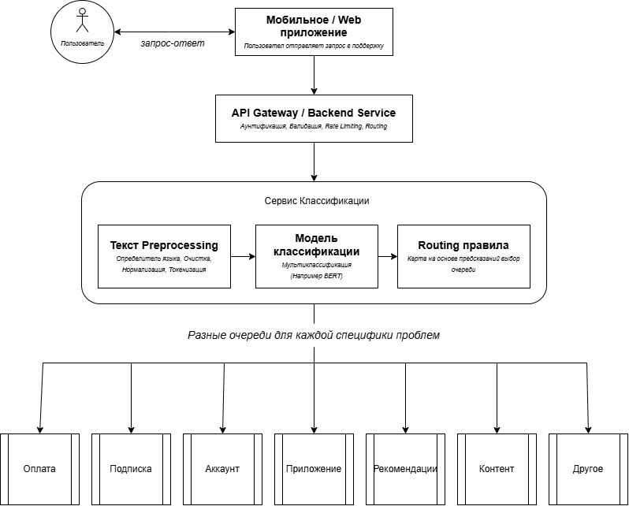

# Презентация: Music Support Triage

**Формат:** 10–15 слайдов, 5 минут + 2 минуты вопросов (уточнить у преподавателя, если 7 минут).  
**Статус:** черновик v0.1 к защите.

## Слайд 1. Титул

Music Support Triage — классификация обращений в поддержку музыкального сервиса.  
Команда: Максим Федулаев, Владимир Егоров, Айдар Мугизов, Евгений Кононов, Александр Аксенов.

## Слайд 2. Проблема

- Поддержка вручную сортирует тикеты.
- Ошибки маршрутизации → задержка ответа.
- Нужна тема + очередь + безопасный fallback.

## Слайд 3. Задача и метрики

- 7 классов, single-label.
- Вход: текст; выход: тема, confidence, top-3, очередь, review flag.
- Macro-F1, per-class recall, selective precision, coverage, p95 latency.

## Слайд 4. Данные

- TWCS SpotifyCares — реальный домен, dev 6 000.
- Bitext — 26 872, вспомогательный домен.
- 420 синтетических — seed.
- Все три источника: 13 847 строк.
- 80/20 stratified by `(source, label)`: train 11 061, test 2 786.
- Validation не выделяется: 5-fold CV на train.
- Test-метки weak/synthetic.

## Слайд 5. Архитектура

- Модульный монолит FastAPI.
- Online-инференс, embedded model.
- Preprocessing → TF-IDF/LogReg → routing → queue/manual.
- 3 узких места: модель, очередь, drift.
- Техническая схема — [`architecture.png`](../02_architecture/architecture.png).

## Слайд 6. API и routing

- `POST /v1/classify`, batch, feedback.
- `GET /healthcheck`, `/model-info`, `/metrics`.
- threshold 0.85 + margin 0.05 → manual.
- Низкая уверенность не маршрутизируется автоматически.

## Слайд 7. Эксперименты

| Семейство | CV macro-F1 |
|---|---|
| **LogReg word+char** | **0.910 ± 0.011** |
| LogReg word | 0.883 ± 0.011 |
| Calibrated SVC | 0.870 ± 0.011 |
| ComplementNB | 0.807 ± 0.008 |

Выбор по CV на train, не по test. Test: macro-F1 0.909, 95% CI [0.876; 0.934].

## Слайд 8. Ошибки и ограничения

- Отрицание: «I don't want to cancel my subscription, I need a receipt» → `subscription`, manual.
- `content` ↔ `recommendations` confusion.
- Test смешивает Bitext, TWCS и synthetic; на TWCS macro-F1 = 0.680.
- Weak labels и разный язык источников.

## Слайд 9. Данные и валидация

- PII-маскирование, дедупликация, group split.
- 8/8 Great Expectations.
- 37 тестов, `ruff`, `mypy`.
- Drift: PSI 0.002, `other_share` 43.3% vs 43.3%.

## Слайд 10. Деплой

- Multi-stage Dockerfile, non-root.
- Compose: api + Prometheus.
- Docker build/up проверены, smoke 5/5.
- Rollback: предыдущий артефакт + перезапуск.

## Слайд 11. Мониторинг

- 3 уровня метрик.
- 4 алерта: API down, model not ready, 5xx, latency.
- `TriageApiDown` проверен в firing.
- Runbook и drift-план.

## Слайд 12. ИИ-ассистенты и этика

- Ассистенты: TZ, данные, код, тесты, отчёт.
- Вручную: таксономия, проверка кода, метрики, выводы.
- PII, bias, automation bias, лицензия TWCS.
- Ограничение: учебный прототип, не production.

## Слайд 13. Следующие шаги

- Contract/load/adversarial тесты на финальном стенде.
- Drift на реальных логах.
- Отдельная human-verified подвыборка как future work.
- Улучшение TWCS-качества и редких классов.
- Презентация и защита.

## Слайд 14. Итог

- Полный путь: задача → архитектура → эксперименты → тесты → деплой → мониторинг.
- Работающий сервис и воспроизводимый pipeline.
- Честно показанные ограничения и следующий шаг.

## Слайд 15. Вопросы

Ссылки: репозиторий, README, report.md, data_card.md, model_card.md.
