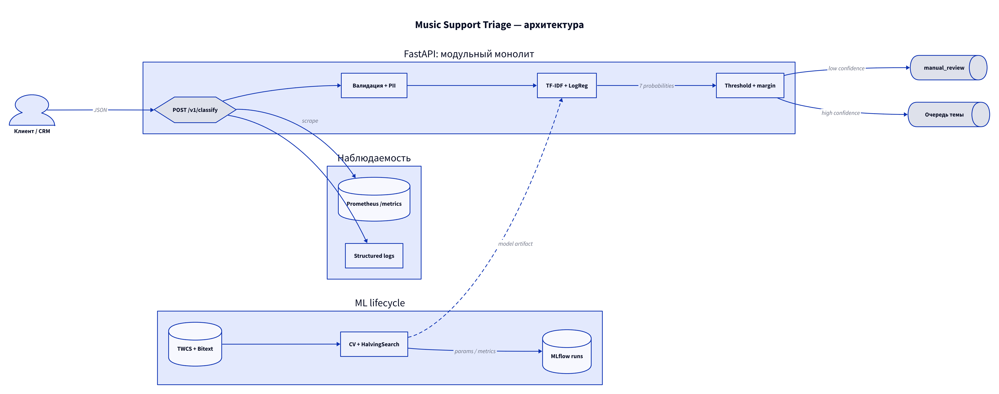

# Итоговый отчёт: Music Support Triage

**Версия:** 1.0, 15.11.2026, после аудита проекта  
**Команда:** Максим Федулаев, Владимир Егоров, Айдар Мугизов, Евгений Кононов, Александр Аксенов  
**Репозиторий:** https://github.com/NexPG/final-project-IAIiD  
**Data card:** [`data_card.md`](../01_task/data_card.md) · **Model card:** [`model_card.md`](../03_experiments/model_card.md)

## 1. Задача и бизнес-контекст

Музыкальный стриминговый сервис получает обращения в поддержку через приложение, сайт, e-mail, чат и Twitter. Первая линия вручную сортирует их по темам, из-за чего растёт время ответа, а часть тикетов попадает не в ту очередь.

Цель — по тексту обращения определить одну из семи тем и предложить очередь. При низкой уверенности обращение уходит на ручную проверку, а не в случайную очередь.

| Класс | Очередь | Пример |
|---|---|---|
| `payment` | `billing` | «Списали дважды», «Где чек?» |
| `subscription` | `subscriptions` | «Отключите автопродление» |
| `account` | `account_support` | «Не приходит код входа» |
| `app` | `technical_support` | «Трек зависает на 10 секунде» |
| `recommendations` | `recommendations` | «Почему мне советуют это?» |
| `content` | `content_support` | «Пропал альбом» |
| `other` | `general_support` | «Хочу предложить сотрудничество» |

**Метрики успеха:** CV macro-F1, test macro-F1 с 95% bootstrap CI, recall каждого класса, selective precision ≥ 0.95, coverage ≥ 0.40, p95 latency ≤ 300 мс.

**Границы:** учебный прототип; нет реальной CRM, автоматических ответов и круглосуточной эксплуатации.

## 2. Этапы проекта и gates

| Этап | Вход | Что делаем | Выход | Gate |
|---|---|---|---|---|
| 1. Задача | Требования курса | Таксономия, метрики, границы, данные | `TZ.md`, `data.md`, `README.md` | закрыт |
| 2. Архитектура | TZ, 7 классов | Монолит, API, routing, ADR | `architecture.md`, `api.md`, `openapi.json` | закрыт |
| 3. Эксперименты | Данные + архитектура | 80/20, CV, HalvingRandomSearchCV, test | `experiments.md`, MLflow, `model_card.md` | закрыт |
| 4. Тестирование | Модель + API | Data/model/API/contract tests | `tests/`, `testing.md` | закрыт |
| 5. Деплой | Сервис | Docker, Compose, smoke, rollback | `deployment.md` | закрыт |
| 6. Мониторинг | Сервис | Метрики, алерты, drift, runbook | `monitoring.md` | закрыт |

Подробная карта gates — [`stages.md`](../01_task/stages.md).

## 3. Архитектура

Выбран **модульный монолит** на FastAPI с моделью в процессе API. Общая схема — [`architecture_overview.png`](../02_architecture/architecture_overview.png), техническая — [`architecture.png`](../02_architecture/architecture.png), Mermaid-версия — в [`architecture.md`](../02_architecture/architecture.md).



**Почему монолит:** команда 5 человек, один потребитель, небольшая нагрузка. **Почему online:** ответ нужен в момент обращения. **Почему classical ML:** TF-IDF + LogReg быстро обучается на CPU, интерпретируем и достаточен для 7 классов; LLM/agent — overengineering.

**Три узких места:**

1. Модель не загрузилась → 503; readiness, checksum, rollback, manual fallback.
2. Очередь/CRM недоступна → retry и manual queue.
3. Drift входных данных → мониторинг, drift-отчёт, переобучение.

**API:** `/v1/classify`, `/v1/classify/batch`, `/v1/feedback`, `/healthcheck`, `/model-info`, `/metrics`. Ответ содержит `request_id`, тему, очередь, confidence, margin, top-3, `needs_human_review`, версию модели. Ошибки — единый конверт с `request_id`; OpenAPI — [`openapi.json`](../02_architecture/openapi.json).

## 4. Технологический стек

| Компонент | Выбор | Причина |
|---|---|---|
| Язык | Python 3.12 | ML/NLP-экосистема |
| API | FastAPI + Pydantic v2 | OpenAPI, валидация, TestClient |
| Модель | TF-IDF + LogisticRegression | CPU, скорость, интерпретируемость |
| Подбор | HalvingRandomSearchCV + StratifiedGroupKFold | Больше комбинаций, successive halving |
| Данные | pandas + PyYAML | Воспроизводимый pipeline |
| Трекинг | MLflow (SQLite) | Runs, params, metrics, artifacts |
| Валидация | Great Expectations | 8 expectations, отчёт |
| Тесты | pytest + httpx | Unit/integration/model |
| Деплой | Docker + Compose | Воспроизводимость |
| Мониторинг | Prometheus + alert rules | Стандарт, демонстративно |

## 5. Данные

Все источники объединены в один пул:

| Источник | Всего | Train | Test |
|---|---|---|---|
| TWCS SpotifyCares | 5 732 | 4 558 | 1 174 |
| Bitext Customer Support | 7 695 | 6 155 | 1 540 |
| **Всего** | **13 427** | **10 713** | **2 714** |

Пул перемешан и разделён **80/20** со стратификацией одновременно по `(source, label)`. Доли test: TWCS 20.5%, Bitext 20.0%; классовые доли сохранены. Validation не выделяется: его роль выполняет 5-fold CV на train.

**Метки:** TWCS weak (keyword/pseudo-label), Bitext mapped. Это не независимая человеческая разметка; test-метрики измеряют согласие с этими метками. Ограничение зафиксировано в data card.

## 6. Эксперименты

### 6.1. Схема

- 5-fold `StratifiedGroupKFold` на train, стратификация по `(source, label)`, группы — `conversation_id`;
- `HalvingRandomSearchCV`: 120 кандидатов, factor=2, resources 2000→4000→8000;
- выбор по mean CV macro-F1; test не используется;
- после выбора — refit на полном train и OOF-порог;
- **одно** измерение на test + 95% bootstrap CI.

### 6.2. Результаты CV

| Семейство | CV macro-F1 | Std |
|---|---|---|
| **logreg_word** | **0.855** | **0.048** |
| logreg_word_char | 0.848 | 0.038 |
| linear_svc (calibrated) | 0.775 | 0.012 |
| complement_nb | 0.701 | 0.006 |

Выбрана `logreg_word`: TF-IDF word (1,2), `min_df=2`, `max_features=50000`, C=32, `class_weight=balanced`. Сильнее всего результат менял выбор семейства/признаков; `class_weight=balanced` важнее конкретного C, а C в диапазоне 4–32 давал лишь небольшие различия.

### 6.3. Финальный test

| Метрика | Значение |
|---|---|
| Accuracy | 0.963 |
| Macro-F1 | **0.855** |
| Weighted-F1 | 0.963 |
| Bootstrap 95% CI | **[0.791; 0.908]** |
| Coverage | 0.881 |
| Selective precision | **0.989** |
| Review rate | 0.119 |

Per-class recall: `payment` 0.97, `subscription` 0.92, `account` 0.96, `app` 0.69, `recommendations` 0.98, `content` 0.40, `other` 0.98.

**Test по источникам (диагностика):**

| Источник | Rows | Accuracy | Macro-F1 |
|---|---|---|---|
| Bitext | 1 540 | 0.998 | 0.713 |
| TWCS | 1 174 | 0.917 | 0.739 |

Overall 0.855 смешивает источники. На реальном TWCS macro-F1 = 0.739; это ограничение, а не результат выбора по test.

### 6.4. Threshold

Порог 0.85 / margin 0.05 выбран по OOF: coverage 0.878, selective precision 0.989. На test — 0.881 и 0.989. Целевые показатели selective precision ≥ 0.95 и coverage ≥ 0.40 выполнены.

## 7. Данные, валидация и тестирование

**Pipeline:** download → clean → PII masking → dedup → 80/20 stratified split → manifest → validation.

**Проверки:** обязательные поля, классы/split/source, длины 10–5000, уникальность id, cross-split дубли, утечка `conversation_id`, PII. Отчёт — `data/processed/validation_report.json`. Great Expectations — **8/8** expectations на 13 427 строках.

**Тесты:** **37 passed**. Покрыты очистка/PII, маппинг, стратифицированный split, дедупликация, data validation, routing, API, OpenAPI, error envelope, batch, feedback idempotency, `/metrics`, model quality (overall, per-class, robustness, edge, behavior, adversarial, subgroup). Локальный quality gate: `ruff`, `mypy`, `pytest`, smoke. **Dirty copy** намеренно ломает данные и должна быть отклонена: GE поймал 4 нарушения из 8. **Load test:** 20 RPS, 30 s, 600 запросов, 0 ошибок, p95 9.74 ms.

**Найденная проблема:** отрицание «I don't want to cancel my subscription, I need a receipt» → `subscription`, confidence 0.647, manual_review. Это и баг качества, и корректное безопасное поведение routing. Дополнительно: `content`/`recommendations` confusion.

## 8. Деплой

- Multi-stage `docker/Dockerfile`, slim, non-root, healthcheck.
- `docker/docker-compose.yml`: API + Prometheus + Grafana, `API_PORT`.
- Модель и конфиги монтируются read-only; feedback — SQLite-volume.
- Smoke `scripts/smoke.py`: healthcheck, model-info, classify, batch, metrics — **5/5** на uvicorn и в Docker.
- Docker build/up проверены: api, Prometheus и Grafana healthy.
- Rollback: предыдущий `model.joblib` + перезапуск.
- CI/CD на GitHub не используется: локальный quality gate и ручной release.

## 9. Мониторинг

**Инфраструктура:** `up`, 5xx rate, p95 latency, CPU/RAM.
**Продукт:** запросы, auto-routed share, manual share, distribution тем.
**Модель:** `model_loaded`, inference latency, confidence, drift.

Метрики — `/metrics`; Prometheus scrape и 7 алертов: `TriageApiDown`, `TriageModelNotReady`, `TriageHigh5xxRate`, `TriageHighLatency`, `TriageManualReviewRateHigh`, `TriageOtherShareHigh`, `TriageConfidenceLow`. Grafana dashboard `Music Support Triage` показывает инфраструктуру, продукт и модель. Алерт проверен: после `docker compose stop api` `TriageApiDown` перешёл в **firing**, после запуска smoke снова 5/5.

**Drift:** `scripts/drift_report.py`: PSI длины **0.003**, KS **0.020**, p = 0.346; `other_share` 44.1% в train и 44.5% в test. Стратифицированный split сохранил распределения; production drift требует реальных логов.

## 10. ИИ-ассистенты

Использовались для: аудита TZ, исследования датасетов, pipeline, API, тестов, Docker, MLflow/GE, отчёта. Проверено вручную: все команды запущены, тесты и линтеры пройдены, метрики пересчитаны, ссылки проверены. Что исправлено командой: порядок вероятностей классов, FastAPI dependency injection, формат `/metrics`, выбор модели и порог, конфликтующие версии артефактов. Не делегировалось: таксономия, выводы экспериментов, этика и защита. Журнал — [`ai_usage.md`](../08_ai/ai_usage.md).

## 11. Ограничения, drift и этика

- Test-метки weak, не human-verified.
- Overall test смешивает Bitext и TWCS; реальный TWCS macro-F1 = 0.739.
- TWCS — публичные твиты с шумом, сарказмом, ссылками и PII; PII маскируется, сырые данные не коммитятся.
- Bitext — retail/support, не музыкальный стриминг.
- `content` и `app` редки.
- Модель не понимает отрицания и сложные multi-topic обращения; такие случаи уходят в manual.
- Automation bias: интерфейс должен показывать confidence и top-3.
- Лицензия TWCS требует уточнения; данные используются локально в учебных целях.

## 12. Заключение

Собран сквозной учебный кейс: от бизнес-задачи и архитектуры до экспериментов, тестов, Docker-деплоя и мониторинга. Все шесть gate-этапов закрыты и подтверждены артефактами. Работающий прототип классифицирует обращения в 7 тем, маршрутизирует их в очередь или `manual_review`, имеет OpenAPI-контракт, 37 тестов, Docker-стек, Grafana и 7 алертов.

Ключевой результат: CV macro-F1 **0.855 ± 0.048**, test macro-F1 **0.855** с 95% CI **[0.791; 0.908]**, selective precision **0.989** при coverage **0.881**. На реальном TWCS качество ниже (0.739) — это ограничение weak-меток и смешанного test, которое честно указано.

Следующий шаг — human-verified подвыборка и регулярное переобучение по дрейфу. Проект не является production-системой, но показывает полный инженерный путь и границы решения.

## 13. Воспроизводимость

```bash
python scripts/download_data.py --config configs/data.yaml
python scripts/build_dataset.py --config configs/data.yaml
python scripts/validate_data.py --config configs/data.yaml
python scripts/validate_data_ge.py
python scripts/search_models.py --n-candidates 120 --factor 2 --min-resources 2000 --max-resources 8000
python scripts/tune_threshold.py
python scripts/drift_report.py
uvicorn music_support_triage.api.app:app --port 8000
python scripts/smoke.py
```

## 14. Роли

| Участник | Этап | Вклад |
|---|---|---|
| Максим Федулаев | 2. Архитектура | Схема, API-контракт, ADR |
| Владимир Егоров | 3. Эксперименты | Данные, CV, HalvingRandomSearchCV, модель, CI |
| Айдар Мугизов | 4. Тестирование | Тест-план, pytest, data validation |
| Евгений Кононов | 5. Деплой | Docker, Compose, smoke, rollback |
| Александр Аксенов | 6. Мониторинг | Метрики, алерты, drift, отчёт |
| Вся команда | 1. Задача | TZ, таксономия, данные, защита |
