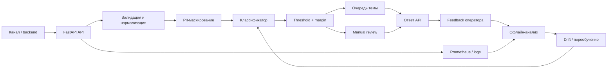

# Техническое задание (TZ)

**Проект:** Классификация обращений в поддержку музыкального сервиса  
**Кодовое имя:** Music Support Triage  
**Репозиторий:** `final-project-IAIiD`  
**Версия документа:** 2.2  
**Дата:** 14.11.2026  
**Статус:** рабочая версия, требуется подтверждение командой  
**Команда:** 5 человек  
**Формат сдачи:** репозиторий + отчёт 5–7 страниц + презентация 10–15 слайдов + защита

> **Главное правило проекта.** Делаем не «как получится» и не «как уже начали», а строго по заданию курса, плану проекта и 16 вебинарам. Если текущий черновик расходится с этим ТЗ — переделываем черновик, а не подгоняем ТЗ. Все отклонения фиксируются в `diary.md` и в отчёте.

---

## 0. Паспорт проекта и источники требований

### 0.1. Паспорт

| Параметр | Значение |
|---|---|
| Тема | Классификация обращений в поддержку музыкального сервиса |
| Тип задачи | Multi-class single-label классификация текста |
| Вход | Текст обращения, опционально тема письма, канал, язык |
| Выход | Тема, confidence, top-k, очередь, флаг ручной проверки, версия модели |
| Основная модель | TF-IDF + Logistic Regression (baseline), optional transformer |
| Сервис | FastAPI, синхронный REST |
| Трекинг | MLflow локально |
| Валидация данных | Great Expectations + pandas-проверки |
| Тесты | pytest, httpx/TestClient, mock-модель |
| Деплой | Docker + Docker Compose, учебный локальный маршрут |
| Мониторинг | Prometheus + Grafana, structured logging, drift-отчёт |
| CI/CD | GitHub Actions **не используется** по решению команды |
| Платные сервисы | Не требуются |
| GPU | Не требуется для базового решения |

### 0.2. Источники требований и приоритет

| Приоритет | Источник | Что берём |
|---|---|---|
| 1 | Задание итогового проекта курса | Цель, состав сдачи, 5–7 страниц отчёта, 10–15 слайдов, критерии оценки, обязательные пункты |
| 2 | Проектная презентация, слайд 3 «Путь проекта» | 6 этапов: Задача → Архитектура → Эксперименты → Тестирование → Деплой → Мониторинг |
| 3 | 16 вебинаров курса | Конкретные методы, инструменты, артефакты и проверки по каждому этапу |
| 4 | Текущие черновики в директориях этапов | Только как исходный материал; обязателен аудит и переделка при расхождении |
| 5 | Официальная документация библиотек | Детали реализации, версии, синтаксис |

**Правило разрешения конфликтов:** задание → план проекта → вебинар → черновик. Если вебинар рекомендует GitHub Actions, а команда решила не использовать CI/CD, это фиксируется как осознанное отклонение с причиной и компенсацией (локальный quality gate).

### 0.3. Термины

| Термин | Значение |
|---|---|
| Обращение / тикет | Текст запроса пользователя в поддержку |
| Тема / класс | Одна из семи целевых категорий |
| Очередь | Команда поддержки, куда маршрутизируется обращение |
| Confidence | Оценка уверенности модели в выбранном классе |
| Margin | Разница между top-1 и top-2 вероятностями |
| Coverage | Доля обращений, автоматически маршрутизированных без ручной проверки |
| Selective precision | Точность на тех обращениях, которые модель взяла на автоматическую маршрутизацию |
| Review rate | Доля обращений, отправленных на ручную проверку |
| Macro-F1 | Среднее F1 по классам; основная метрика из-за дисбаланса |
| Data drift | Изменение распределения входных данных |
| Concept drift | Изменение связи «текст → тема» |
| Quality gate | Набор обязательных локальных проверок перед демо/релизом |
| MLOps | Процесс вокруг модели: данные, эксперименты, деплой, мониторинг |

---

## 1. Цель, границы и критерии успеха

### 1.1. Бизнес-контекст

Музыкальный стриминговый сервис получает обращения через приложение, сайт, email и чат. Сейчас операторы первой линии вручную определяют тему и передают тикет в одну из очередей. Это приводит к:

- долгому времени до попадания в нужную очередь;
- ошибкам маршрутизации;
- неравномерной нагрузке на операторов;
- потере контекста при пересылке;
- отсутствию системного анализа тем обращений.

### 1.2. Цель проекта

Создать воспроизводимый прототип ML-сервиса, который:

1. классифицирует текст обращения по семи темам;
2. возвращает confidence и top-k альтернатив;
3. маршрутизирует обращение в очередь;
4. при низкой уверенности или неоднозначности отправляет его на ручную проверку;
5. отдаёт метрики для наблюдения за качеством;
6. имеет тесты, Docker-запуск и план мониторинга.

### 1.3. Задачи

1. Зафиксировать таксономию и правила маршрутизации.
2. Подготовить и провалидировать учебный датасет.
3. Провести не менее трёх вариантов экспериментов и не менее пяти MLflow-запусков.
4. Реализовать FastAPI-сервис с контрактом, healthcheck и model-info.
5. Покрыть данные, модель и код тестами; найти и описать минимум одну реальную проблему.
6. Подготовить Dockerfile и Docker Compose.
7. Определить технические, продуктовые и модельные метрики, алерты и runbook.
8. Описать drift, переобучение, этические риски и ограничения.
9. Честно описать использование ИИ-ассистентов.
10. Подготовить README, отчёт 5–7 страниц и презентацию 10–15 слайдов.

### 1.4. Границы проекта

| Входит | Не входит |
|---|---|
| Классификация текста по 7 темам | Автоматический ответ пользователю |
| REST API и OpenAPI | Полноценная CRM |
| Маршрутизация и флаг ручной проверки | Реальная интеграция с Zendesk/Intercom |
| Учебный датасет и разметка | Сбор реальных PII |
| Baseline и сравнение моделей | Обучение LLM с нуля |
| Docker Compose локально | Kubernetes и облако |
| Prometheus/Grafana | Круглосуточная эксплуатация |
| Тесты и тест-план | Пентест и аудит безопасности промышленного уровня |
| Отчёт и презентация | Коммерческий продукт |

### 1.5. Критерии успеха

| Уровень | Метрика | Целевое значение |
|---|---|---|
| Модель | Macro-F1 на human-verified test | ≥ 0.80 (минимум 0.75 с обоснованием) |
| Модель | 95% bootstrap CI для macro-F1 | публикуется, нижняя граница анализируется |
| Модель | Recall каждого класса | ≥ 0.65 |
| Маршрутизация | Selective precision при auto-routing | ≥ 0.95 |
| Маршрутизация | Coverage | ≥ 0.40 |
| Маршрутизация | Review rate | ≤ 0.60 |
| Калибровка | ECE после калибровки | ≤ 0.10 |
| Сервис | p95 latency (TF-IDF, CPU) | ≤ 300 мс |
| Сервис | p95 latency (общий контракт) | ≤ 500 мс |
| Сервис | 5xx на корректных запросах | < 1% |
| Проект | Воспроизводимость | Повторный запуск по README |

Если цель по coverage/precision не достигается, используется **assistive mode**: модель показывает тему оператору, но автоматическая маршрутизация выключена. Это допустимый, честно описанный результат, но он должен быть обоснован в отчёте.

---

## 2. Команда, роли и этапы

### 2.1. Состав команды

Команда — 5 человек. По заданию курса основной формат 3–4 человека, 5 допускается по согласованию с преподавателем. **Нужно подтвердить допуск команды из 5 человек.**

| Участник | Этап | Роль | Зона ответственности | Backup |
|---|---|---|---|---|
| Федулаев Максим | Этап 2. Архитектура | Архитектор / backend | Схема, API-контракт, ADR, интеграция | Владимир Егоров |
| Владимир Егоров | Этап 3. Эксперименты | ML-инженер / data | Данные, разметка, MLflow, модель | Айдар Мугизов |
| Айдар Мугизов | Этап 4. Тестирование | QA / ML-инженер | Тест-план, pytest, data validation, найденные проблемы | Евгений Кононов |
| Евгений Кононов | Этап 5. Деплой | DevOps / backend | Dockerfile, Compose, release, rollback | Александр Аксенов |
| Александр Аксенов | Этап 6. Мониторинг | MLOps / документация | Метрики, алерты, drift, отчёт | Максим Федулаев |

**Распределение утверждено командой:** Максим Федулаев — этап 2, Владимир Егоров — этап 3, Айдар Мугизов — этап 4, Евгений Кононов — этап 5, Александр Аксенов — этап 6. Этап 1 «Задача» отдельного владельца не имеет: его выполняет вся команда, координирует Максим Федулаев.

### 2.2. Шесть этапов проекта (из слайда 3)

| № | Этап | Владелец | Ключевой результат | Артефакты | Критерий завершения |
|---|---|---|---|---|---|
| 1 | Задача | Вся команда | Понятная задача и границы | TZ, README, таксономия, план данных | Задача, вход и выход согласованы |
| 2 | Архитектура | Максим Федулаев | Схема и контракт | `docs/architecture.md`, `docs/api.md`, ADR, OpenAPI | Схема читаема, контракт проверяем |
| 3 | Эксперименты | Владимир Егоров | Сравнение ≥3 вариантов | данные, MLflow, `docs/experiments.md`, model card | Есть вывод по каждому запуску |
| 4 | Тестирование | Айдар Мугизов | Тесты и найденная проблема | `tests/`, `docs/testing.md`, risk log | Критические сценарии покрыты |
| 5 | Деплой | Евгений Кононов | Воспроизводимый запуск | Dockerfile, Compose, `docs/deployment.md` | `docker compose up` работает |
| 6 | Мониторинг | Александр Аксенов | Метрики и алерты | `docs/monitoring.md`, дашборд, alert rules | Есть ≥1 алерт и runbook |

### 2.3. Семь этапов жизненного цикла (вебинар 1) и их связь с проектом

Вебинар 1 задаёт 7 этапов ЖЦ. Шесть этапов проекта — это управленческая разбивка; семь этапов ЖЦ используем для содержательного описания.

| № | Этап ЖЦ | Что делаем в проекте | Роль | Риск | Этап проекта |
|---|---|---|---|---|---|
| 1 | Бизнес-задача | Снижаем время маршрутизации и ошибки | Вся команда | Метрика успеха не связана с бизнесом | 1 |
| 2 | ML-задача и метрика | Multi-class классификация, macro-F1, coverage | Владимир Егоров | Метрика не отражает цену ошибки | 1, 3 |
| 3 | Данные | Сбор, разметка, валидация, версии | Владимир Егоров | Слабые метки, шум и утечки | 3 |
| 4 | Эксперименты | Baseline, 5+ запусков, выбор модели | Владимир Егоров | Переобучение на test | 3 |
| 5 | Тестирование | Данные, модель, код, интеграции | Айдар Мугизов | Пропущенные пограничные случаи | 4 |
| 6 | Деплой | FastAPI, Docker, Compose, release | Евгений Кононов | Сломанный контракт/окружение | 5 |
| 7 | Мониторинг | Метрики, алерты, drift, переобучение | Александр Аксенов | Деградация незаметна | 6 |

**Артефакт этапа 1/2:** схема ЖЦ на 7 блоков, у каждого — роль и минимум один риск (по практике вебинара 1).

---

## 3. Требования задания → артефакты → проверка

| Требование задания | Где в ТЗ | Артефакт | Как проверяется |
|---|---|---|---|
| Задача и бизнес-контекст | §1 | README, TZ | Преподаватель понимает задачу |
| Архитектура и компоненты | §7 | `docs/architecture.md` | Схема, ADR, 3 узких места |
| Обоснование стека | §7.9 | TZ, architecture | Таблица выборов и альтернатив |
| ≥3 эксперимента с выводом | §9 | `docs/experiments.md`, MLflow | ≥5 runs, таблица, вывод |
| Валидация данных и тест-план | §6, §10 | data card, `docs/testing.md` | ≥5 GE checks, тесты |
| Найденная проблема/риск | §10.7 | risk log, отчёт | Конкретный пример и фикс |
| Деплой/контейнеризация | §11 | Dockerfile, Compose | `docker compose up`, smoke |
| Мониторинг и алерт | §12 | `docs/monitoring.md` | 3 уровня метрик, ≥1 алерт |
| ИИ-ассистенты | §13 | `docs/ai_usage.md` | Задачи, проверка, исправления |
| Ограничения, drift, этика | §13, §1.4 | отчёт | Честный раздел |
| README | §18 | `README.md` | Задача, структура, запуск, роли |
| Отчёт 5–7 страниц | §16 | `docs/report.md` / PDF | 9 пунктов задания |
| Презентация 10–15 слайдов | §16 | отдельный файл | 5 минут + вопросы |
| Роли участников | §2 | README, отчёт | 5 имён и зон |

---

## 4. Пользователи и сценарии

### 4.1. Пользователи

| Пользователь | Потребность |
|---|---|
| Пользователь сервиса | Быстро получить помощь в правильной очереди |
| Оператор первой линии | Меньше ручной сортировки, понятная причина маршрута |
| Тимлид поддержки | Распределение тем, нагрузка, качество |
| ML-инженер | Воспроизводимое обучение и обновление модели |
| Дежурный инженер | Понять, что сломалось, и что делать |

### 4.2. Основной сценарий

1. Пользователь отправляет обращение.
2. Backend передаёт текст в `POST /v1/classify`.
3. Сервис валидирует, нормализует, маскирует PII.
4. Модель возвращает вероятности по 7 темам.
5. Routing применяет threshold, margin и правила.
6. При достаточной уверенности — очередь темы.
7. При низкой уверенности/неоднозначности — `manual_review`.
8. Ответ содержит `request_id`, тему, confidence, top-k, очередь, флаг, версию модели.
9. Логи и метрики обновляются; оператор может отправить feedback.

### 4.3. Альтернативные сценарии

| Ситуация | Поведение |
|---|---|
| Пустой текст | `422 TEXT_TOO_SHORT` |
| Текст > 5000 символов | `422 TEXT_TOO_LONG` |
| Batch > 100 | `422 BATCH_TOO_LARGE` |
| Модель не загружена | `/healthcheck` = 503, классификация = 503, upstream → manual |
| Низкий confidence | `manual_review`, `needs_human_review=true` |
| Маленький margin | `manual_review` |
| `other` с высокой уверенностью | `general_support`, без обязательной ручной проверки |
| Смешанный язык | Классификация + метрика; при низкой уверенности — manual |
| PII | Маскируется до логирования |

---

## 5. Таксономия и маршрутизация

### 5.1. Семь классов

Таксономия сохраняет 7 классов из архитектурного черновика команды, потому что они покрывают реальные процессы поддержки музыкального сервиса. Границы классов уточнены, чтобы уменьшить пересечения.

| Код | Класс | Что относится | Примеры | Очередь |
|---|---|---|---|---|
| `payment` | Оплата | Списания, платёжные ошибки, чеки, возвраты, карты | «Списали дважды», «Где чек?» | `billing` |
| `subscription` | Подписка | Тариф, продление, отмена, семейный доступ, промо, премиум | «Отключите автопродление» | `subscriptions` |
| `account` | Аккаунт | Вход, пароль, 2FA, профиль, безопасность, удаление данных | «Не приходит код входа» | `account_support` |
| `app` | Приложение | Плеер, зависания, звук, офлайн, устройства, интерфейс | «Трек зависает на 10 секунде» | `technical_support` |
| `recommendations` | Рекомендации | Персональные подборки, вкусы, лайки, нежелательные советы | «Почему мне советуют это?» | `recommendations` |
| `content` | Контент | Каталог, права, конкретные треки/альбомы, метаданные | «Пропал альбом», «Не находится исполнитель» | `content_support` |
| `other` | Другое | Понятные, но внеклассовые запросы: партнёрство, пресса, вакансии | «Хочу предложить сотрудничество» | `general_support` |

### 5.2. Границы классов

| Спорная пара | Правило |
|---|---|
| Оплата / Подписка | Оплата — транзакция, сумма, чек, возврат; Подписка — тариф, срок, отмена, продление. Если оба намерения равнозначны — manual. |
| Аккаунт / Подписка | Аккаунт — вход, пароль, профиль; Подписка — план и платежи. |
| Приложение / Контент | Приложение — воспроизведение и техпроблемы; Контент — наличие и метаданные. |
| Рекомендации / Контент | Рекомендации — персонализация и вкусы; Контент — каталог и права. |
| Другое / неопределимо | Другое — понятный запрос вне тем; неопределимо — manual, тема не подменяется на «Другое». |

### 5.3. Правила маршрутизации

1. Auto: `confidence >= threshold`, `margin >= margin_threshold`, `topic != other`, текст содержит буквы и не менее 2 токенов.
2. Manual: `confidence < threshold` или `margin < margin_threshold` или несколько равнозначных тем.
3. `other` при высокой уверенности → `general_support`; при низкой → `manual_review`.
4. Модель недоступна → 503; upstream направляет в manual.
5. Пороги калибруются по OOF-предсказаниям train, фиксируются в конфиге и возвращаются в ответе.

---

## 6. Данные

### 6.1. Решение по языку и объёму

Проект **англоязычный**. Это учебный кейс, и требование «только русский датасет» не является обязательным. Английский выбран потому, что для него есть большой реальный корпус обращений именно музыкального стриминга, а не только синтетика:

- **TWCS SpotifyCares** — реальные публичные диалоги поддержки Spotify в Twitter (~38 тыс. обращений бренда в полном TWCS из 2,81 млн твитов). Домен совпадает с задачей, но официальных тематических меток нет.
- **Bitext Customer Support** — 26 872 чистых англоязычных примера, 27 интентов и 10 категорий. Домен общий (retail/support), поэтому используем как вспомогательный train, а не как основной test.
- **420 синтетических музыкальных обращений** — seed и пограничные случаи.
- **Audio Retailer Customer Support Tickets** — 1 000 синтетических тикетов, 6 отделов, MIT. Только внешняя проверка обобщения, не train и не test.

Русский язык остаётся опциональным расширением на будущее: контракт API допускает `locale`, но финальные метрики считаются на английском.

**Принцип доверия:** train может быть слабо размеченным и содержать синтетику; test — только human-verified примеры из реального домена SpotifyCares. Метрики на синтетике и слабых метках не выдаются за финальные.

### 6.2. Источники, лицензии и роль

| Источник | Объём | Роль | Лицензия / статус | Ограничение |
|---|---|---|---|---|
| TWCS SpotifyCares | ~38 тыс. обращений; готовый dev-подкорпус 6 000 | Основной домен, train + human-verified eval | Лицензия TWCS требует уточнения; сырые твиты не коммитим | Нет официальных тем; PII; шум |
| Bitext Customer Support | 26 872 | Вспомогательный train | CDLA-Sharing-1.0 | Другой домен; маппинг категорий |
| Синтетические 420 | 420 | Seed и edge cases в train | Собственная генерация | Не в test |
| Audio Retailer | 1 000 | Внешняя проверка обобщения | MIT | Синтетика, другой бизнес |
| Human-written музыкальные кейсы | 300–600 | Дополнение редких классов | Собственная разметка | Только после двойной проверки |

**Маппинг меток в 7 классов:**

| Целевой класс | TWCS-интенты | Bitext-категории |
|---|---|---|
| `payment` | `billing_payment`, refund-часть `cancellation_refund` | PAYMENT, INVOICE, REFUND, CANCEL |
| `subscription` | `subscription_plan`, cancellation-часть `cancellation_refund` | SUBSCRIPTION, ORDER (только cancel/change) |
| `account` | `account_access`, `account_data_privacy` | ACCOUNT, CONTACT |
| `app` | `playback_technical` | — (дополняем синтетикой и audio-retailer Tech Support) |
| `recommendations` | `feature_request_feedback` | FEEDBACK |
| `content` | `content_availability` | — (дополняем human-written) |
| `other` | `ads_free_tier_complaint`, `general_complaint_dissatisfaction`, `other` | ORDER (place/track), DELIVERY, SHIPPING |

Маппинг `cancellation_refund` выполняется по тексту: возврат денег/списание → `payment`, отмена плана → `subscription`. Если сигналов нет — `other` или ручная проверка.

### 6.3. Целевой объём и split

| Параметр | Минимум | Цель |
|---|---|---|
| Train (weak + synthetic + human) | 8 000 | 15 000–20 000 |
| Validation | не выделяется | CV на train |
| Test, human-verified SpotifyCares | 350 | 400 |
| Test на класс в balanced subset | 25 | 30–40 |
| `other` в train | ≤ 40% | ≤ 35% |
| Синтетика в train | ≤ 15% | ≤ 10% |
| Синтетика и weak в test | 0% | 0% |
| Дубли и near-duplicates между split | 0 | 0 |

**Практическая сборка train:**

- TWCS SpotifyCares: до 12 000 слабо размеченных обращений; `other` ограничен 35%, редкие классы сохраняются полностью.
- Bitext: 6 000–8 000 сбалансированных примеров после маппинга; вес при обучении ниже, чем у TWCS.
- Синтетика: 420 после аудита; только train.
- Human-verified SpotifyCares train: 300–500, если команда успевает разметить больше, чем нужно для test.
- Итого ориентир: 15 000–20 000 train, 400 test. Validation не выделяется: его роль выполняет `StratifiedGroupKFold` CV на train, а порог выбирается по OOF-предсказаниям.

**Редкие классы.** В TWCS `content` и `recommendations` почти отсутствуют: в dev-подкорпусе 6 000 их 22 и 55 соответственно. Поэтому:

1. В train редкие классы дополняются human-written музыкальными кейсами и синтетикой.
2. В test сначала набираем естественное распределение, затем отдельно формируем **balanced stress subset** по 25–30 примеров на класс.
3. Метрики на естественном и balanced-подмножествах публикуем раздельно. Если класс меньше 25 примеров, доверительный интервал широкий, и это честно указывается.

Если данных меньше цели, минимальный допустимый вариант — 8 000 train, 350 test. Меньше — только с явным описанием ограничения и риска для оценки.

### 6.4. Схема записи

| Поле | Тип | Обязательно | Описание |
|---|---|---|---|
| `id` | string | да | Уникальный ID |
| `text` | string | да | Текст обращения |
| `subject` | string | нет | Тема письма |
| `label` | enum | да | Один из 7 классов |
| `scenario_id` | string | нет | Группа переформулировок; для реальных твитов — `conversation_id` |
| `split` | enum | да | `train`, `validation`, `test` |
| `source` | enum | да | `weak_twcs`, `bitext`, `synthetic`, `human`, `external_audio` |
| `label_quality` | enum | да | `human_verified`, `weak`, `synthetic` |
| `channel` | enum | да | `twitter`, `app`, `web`, `email`, `chat` |
| `locale` | enum | да | `en`, `ru`, `mixed` |
| `annotator_1` | string | да | Псевдоним разметчика |
| `annotator_2` | string | нет | Второй разметчик |
| `adjudicated` | bool | да | Разрешено ли расхождение |
| `pii_flags` | list[string] | нет | Типы PII |
| `notes` | string | нет | Комментарий |

### 6.5. Разметка

1. Аннотационная инструкция с определениями 7 классов, границами и примерами из TWCS.
2. Выборка для разметки — только SpotifyCares; сначала дедупликация и маскирование PII.
3. Два независимых разметчика на 200+ примерах; Cohen's kappa ≥ 0.70.
4. Расхождения — арбитраж третьим участником; спорные случаи дополняют инструкцию.
5. Test — human-verified; синтетика и слабые метки запрещены. Отдельный validation не выделяется: его роль выполняет CV на train.
6. Test замораживается до финальных экспериментов и не используется для подбора.
7. Разметчик не видит предсказания модели и чужие метки.
8. Слабая разметка TWCS для train проверяется на аудите 500 примеров: agreement с человеком фиксируется в data card.

### 6.6. Валидация данных (вебинар 6)

Проблемы, которые обязательно проверяем:

- пропуски;
- дубликаты и near-duplicates;
- пустые/слишком короткие/слишком длинные тексты;
- несогласованные категории;
- schema drift;
- утечка test в train по `conversation_id`, `scenario_id` и near-duplicates;
- дисбаланс классов и доля `other`;
- доля синтетики и слабых меток;
- PII в реальных твитах (handles, email, телефон, URL);
- язык и mixed-language;
- совпадение текста между TWCS и Bitext после нормализации;
- согласованность `label_quality` и `split` (в eval только `human_verified`).

Минимум 5 проверок Great Expectations + pandas-проверки. Дополнительно:

- намеренно испорченная копия данных;
- отчёт `DataDocs`/JSON;
- обучение останавливается, если исходные данные не прошли проверки;
- отчёт о найденных проблемах переносится в `docs/testing.md` и отчёт.

### 6.7. Приватность и хранение

- Публичные твиты TWCS могут содержать PII: handles, email, телефоны, ссылки. Перед разметкой и логированием выполняется маскирование.
- Сырые TWCS/Bitext-файлы хранятся только локально в `data/external/` и не коммитятся.
- В репозиторий попадают только скрипты загрузки, манифест, агрегированная статистика и небольшие обезличенные примеры.
- Синтетические PII-кейсы создаются специально для тестов маскирования.
- После защиты локальные копии данных удаляются.
- В отчёте и data card указываются лицензии и ограничения каждого источника.

### 6.8. Версионирование

Каждый эксперимент фиксирует:

- Git commit;
- SHA-256 манифеста данных (`data/manifest.json`);
- версию аннотационной инструкции;
- seed;
- версии зависимостей;
- конфиг обучения.

DVC опционален. Минимально достаточно manifest + Git + MLflow.

### 6.9. Data card

Обязательные разделы:

- происхождение и лицензии;
- объём и split;
- распределение классов;
- правила разметки;
- доля синтетики;
- известные смещения;
- PII;
- ограничения;
- версия и checksum.

---

## 7. Архитектура

### 7.1. Принципы

1. Простота: один FastAPI-сервис, модель в процессе.
2. Безопасный отказ: низкая уверенность → manual, а не неверный маршрут.
3. Stateless API.
4. Воспроизводимость: данные, модель, конфиг, версии.
5. Наблюдаемость: request_id, structured logs, метрики.
6. Разделение модулей: preprocessing, model, routing, monitoring.

### 7.2. Монолит vs микросервисы (вебинар 2)

| Критерий | Монолит | Микросервисы | Решение проекта |
|---|---|---|---|
| Размер команды | Маленькая | Несколько команд | 5 человек → монолит |
| Частота обновления модели | Низкая/средняя | Высокая, независимая | Средняя → модульный монолит |
| Нагрузка | Небольшая | Требует отдельного масштабирования | Учебная → монолит |
| Число потребителей | Один | Несколько продуктов | Один сервис → монолит |
| Сложность | Низкая | Высокая | Выбираем низкую |

**Решение:** модульный монолит / один сервис. В production-маршруте модель можно вынести в отдельный model-as-a-service, если появятся другие потребители или GPU.

### 7.3. Batch vs stream (вебинар 2)

| Критерий | Batch | Stream / online | Решение |
|---|---|---|---|
| Задержка | Минуты–сутки | Секунды | Нужен ответ при создании тикета → online |
| Инфраструктура | Job по расписанию | Постоянный сервис | FastAPI |
| Стоимость | Ниже | Выше | Учебная нагрузка → online допустим |
| Сценарий | Пересчёт архива | Маршрутизация нового тикета | Online + optional batch endpoint |

**Решение:** синхронный online-сервис для нового обращения; batch-эндпоинт — опционально для повторной обработки архива.

### 7.4. Паттерн интеграции модели

| Паттерн | Плюсы | Минусы | Решение |
|---|---|---|---|
| Model-as-a-Service | Независимое масштабирование, обновление | Сетевая задержка, отдельная точка отказа | На будущее |
| Embedded model | Быстро, без сети, просто | Связана с приложением | Для курса |

**Решение:** embedded model в FastAPI. В production — отдельный model service при нескольких потребителях.

### 7.5. Classical ML vs LLM/agent (вебинар 2, 14)

| Критерий | Classical ML | LLM / agent |
|---|---|---|
| Данные | Нужна разметка | Гибкость через промпт |
| Стоимость | Низкая | Высокая |
| Задержка | Миллисекунды | Секунды |
| Предсказуемость | Высокая | Ниже |
| Приватность | Локально | Зависит от провайдера |
| Задача | Узкая классификация | Широкие/агентные задачи |

**Решение:** classical ML (TF-IDF + LogReg, optional transformer). LLM/agent не используется в инференсе: задача узкая, нужны низкая задержка, дешёвый вызов, детерминизм и приватность. LLM допустим только для генерации синтетических данных и как ИИ-ассистент разработки — с ручной проверкой.

### 7.6. Компоненты

| Компонент | Ответственность | Реализация |
|---|---|---|
| Канал / backend | Источник тикета | Внешняя система / демо-клиент |
| API | Валидация, версия, ошибки | FastAPI + Pydantic v2 |
| Preprocessing | Нормализация, очистка, PII | Python-модуль |
| Classifier | Вероятности по 7 классам | scikit-learn / optional transformer |
| Routing | threshold, margin, очередь, review | Python-модуль |
| Feedback | Подтверждение/исправление оператора | SQLite/JSONL |
| Monitoring | Метрики, логи, алерты | Prometheus/Grafana |
| Experiment tracking | Параметры, метрики, артефакты | MLflow |
| Model registry | Версии и checksum | MLflow / файловый реестр |

### 7.7. Схема



### 7.8. Поток обработки

1. Запрос `POST /v1/classify`.
2. Pydantic-валидация.
3. Нормализация: Unicode NFC, пробелы, HTML, повторяющиеся символы.
4. PII-маскирование.
5. Инференс.
6. Routing.
7. Ответ + метрики + лог.
8. Feedback (опционально).
9. Офлайн: drift, error analysis, переобучение.

### 7.9. Три узких места (вебинар 2)

| Узкое место | Что произойдёт при отказе | Митигация |
|---|---|---|
| Модель/артефакт не загрузился | Все запросы 503, маршрутизация остановлена | checksum, readiness, rollback, manual queue |
| Backend/очередь недоступна | Тикет не попадает в очередь | retry, очередь сообщений, manual fallback |
| Входные данные изменились (drift) | Тихие ошибки, падение качества | мониторинг, drift-отчёт, переобучение |

### 7.10. Технологический стек

| Компонент | Выбор | Почему | Альтернатива |
|---|---|---|---|
| Язык | Python 3.12 | ML/NLP-экосистема | — |
| API | FastAPI + Pydantic v2 | OpenAPI, валидация, async | Flask |
| Baseline | TF-IDF + LogReg | Быстро, интерпретируемо, CPU | Naive Bayes |
| Optional model | DistilBERT / MiniLM embeddings | Контекст, английский, CPU-friendly | RoBERTa-base |
| Tracking | MLflow | Локально, без регистрации | W&B |
| Data validation | Great Expectations | Явные expectations, DataDocs | pandas-only |
| Tests | pytest + httpx | Unit/integration/mock | unittest |
| Deploy | Docker + Compose | Воспроизводимость | venv |
| Monitoring | Prometheus + Grafana | Стандарт, демонстративно | logs only |
| Drift | Evidently + KS/PSI | Отчёт и статистика | manual |

### 7.11. ADR

| ID | Решение | Причина | Последствия |
|---|---|---|---|
| ADR-01 | Модульный монолит | 5 человек, один сервис, низкая нагрузка | В production можно выделить model service |
| ADR-02 | Online-обработка | Нужен ответ при создании тикета | Постоянный сервис, latency-контроль |
| ADR-03 | Embedded model | Простота и скорость | Модель масштабируется вместе с API |
| ADR-04 | Classical ML, без LLM в инференсе | Цена, задержка, приватность, детерминизм | Нужна разметка и переобучение |
| ADR-05 | 7 классов | Покрывают бизнес-процессы | Есть спорные пары, нужна разметка |
| ADR-06 | Human-in-the-loop | Снижение цены ошибки | Рост review rate |
| ADR-07 | MLflow локально | Без платных сервисов | Нет облачного UI |
| ADR-08 | Без GitHub CI/CD | Решение команды | Локальный quality gate и ручной релиз |
| ADR-09 | Feature store не используем | Одна модель, простые признаки | Нет training-serving skew из-за feature store |

---

## 8. API-контракт

### 8.1. Принципы

- REST, JSON, UTF-8.
- Версия в пути: `/v1`.
- Время ISO 8601 UTC.
- `request_id` в каждом ответе и логе.
- Единый формат ошибок.
- OpenAPI генерируется FastAPI: `/openapi.json`, `/docs`.
- Семантическое версионирование API, модели и данных — отдельно.

### 8.2. Эндпоинты

| Метод | Путь | Назначение | Обязательность |
|---|---|---|---|
| POST | `/v1/classify` | Классификация одного обращения | Must |
| POST | `/v1/classify/batch` | Пакетная классификация до 100 | Should |
| POST | `/v1/feedback` | Обратная связь оператора | Should |
| GET | `/healthcheck` | Liveness + readiness | Must |
| GET | `/model-info` | Версия, дата, метрики, порог | Must |
| GET | `/metrics` | Prometheus | Must |

### 8.3. Запрос

```json
{
  "text": "I was charged for a subscription I cancelled yesterday.",
  "subject": "Duplicate charge",
  "channel": "app",
  "locale": "en"
}
```

Ограничения:

- `text`: 10–5000 символов;
- `subject`: 0–300;
- `channel`: `twitter`, `app`, `web`, `email`, `chat`;
- `locale`: `en`, `ru`, `mixed`;
- неизвестные поля запрещены (`extra=forbid`).

### 8.4. Ответ

```json
{
  "request_id": "6f1c2a3e-7b4d-4f8a-9c1e-2d3b4a5c6d7e",
  "topic": "payment",
  "confidence": 0.93,
  "top_k": [
    {"topic": "payment", "confidence": 0.93},
    {"topic": "subscription", "confidence": 0.04},
    {"topic": "account", "confidence": 0.02}
  ],
  "queue": "billing",
  "needs_human_review": false,
  "model": {
    "name": "tfidf-logreg",
    "version": "1.0.0",
    "trained_at": "2026-11-20T10:00:00Z",
    "confidence_threshold": 0.70,
    "margin_threshold": 0.10
  },
  "processed_at": "2026-11-20T10:05:12Z"
}
```

### 8.5. Ошибки

```json
{
  "error": {
    "code": "TEXT_TOO_SHORT",
    "message": "Поле text должно содержать не менее 10 символов",
    "request_id": "6f1c2a3e-7b4d-4f8a-9c1e-2d3b4a5c6d7e"
  }
}
```

| HTTP | Код | Причина |
|---|---|---|
| 400 | `BAD_REQUEST` | Некорректный JSON |
| 422 | `VALIDATION_ERROR` | Ошибка схемы |
| 422 | `TEXT_TOO_SHORT` | < 10 символов |
| 422 | `TEXT_TOO_LONG` | > 5000 символов |
| 422 | `BATCH_TOO_LARGE` | > 100 |
| 429 | `RATE_LIMITED` | Превышен лимит |
| 500 | `INTERNAL_ERROR` | Непредвиденная ошибка |
| 503 | `MODEL_UNAVAILABLE` | Модель не загружена |

### 8.6. SLA и лимиты

| Параметр | Значение |
|---|---|
| p95 latency | ≤ 300 мс для TF-IDF, ≤ 500 мс общий контракт |
| p99 latency | ≤ 1000 мс |
| Throughput демо | ≥ 20 RPS на 1 worker |
| Max text | 5000 символов |
| Batch | 100 |
| Rate limit | 10 RPS на клиента |
| Timeout | 10 секунд |
| Availability демо | 99% в рамках демонстрации |

### 8.7. Версионирование (вебинар 3)

Версионируются отдельно:

- **API:** `v1`, `v2`; MAJOR ломает совместимость, MINOR добавляет поле, PATCH исправляет.
- **Модель:** `MAJOR.MINOR.PATCH`; model version возвращается в ответе.
- **Данные:** `dataset_version` + SHA-256 manifest.

Примеры:

- MINOR: добавили `top_k` — старые клиенты работают.
- MAJOR: переименовали `topic` → `class` — нужен `/v2`.

Скрытые зависимости запрещены: всё, на что опирается клиент, должно быть в контракте. Feature store не используется: одна модель и простые признаки, training-serving skew решается общим preprocessing-модулем.

---

## 9. ML-решение и эксперименты

### 9.1. Постановка

Multi-class single-label классификация:

- вход: текст (+ subject/channel/locale);
- выход: распределение по 7 классам;
- основная метрика: macro-F1 на human-verified test + 95% bootstrap CI;
- выбор модели: mean CV macro-F1 на train;
- дополнительные: per-class P/R/F1, accuracy, coverage, selective precision, review rate, ECE, latency.

### 9.2. Baseline

- Keyword baseline (существующий) — нижняя граница и sanity check.
- TF-IDF word (1–2 gram) + Logistic Regression.
- TF-IDF word + char (3–5 gram) + Logistic Regression.
- Calibrated LinearSVC и ComplementNB — альтернативные семейства.
- `class_weight="balanced"`, `StratifiedGroupKFold(5)` по `conversation_id`, scoring=`f1_macro`.

### 9.3. Эксперименты (минимум 3 варианта, 5+ MLflow runs)

| ID | Гипотеза | Конфигурация | Что сравниваем |
|---|---|---|---|
| E0 | Keyword baseline даст нижнюю границу | эвристики | macro-F1, latency |
| E1 | LogReg word лучше keyword | TF-IDF word + LogReg, RandomizedSearchCV | CV macro-F1, std |
| E2 | Char n-grams помогают на опечатках | word+char + LogReg | CV macro-F1, robustness |
| E3 | LinearSVC/CNB конкурентен | calibrated SVC / ComplementNB | CV macro-F1, скорость |
| E4 | OOF threshold повышает selective precision | threshold/margin по OOF | coverage, selective precision, review rate |
| E5 (optional) | Transformer/embeddings лучше на перефразированиях | DistilBERT или MiniLM + LogReg | macro-F1, latency, размер |

**Правило:** `RandomizedSearchCV(n_iter=12, cv=StratifiedGroupKFold(5), scoring="f1_macro")`. Test не используется для выбора. Финальная оценка — один раз, с 95% bootstrap CI.

Каждый запуск логирует:

- params: модель, C, ngram_range, seed, dataset_version;
- metrics: CV mean/std, test macro-F1 + bootstrap CI, accuracy, per-class recall, coverage, ECE;
- artifacts: model, confusion matrix, classification report, config, data hash;
- tags: code_sha256, dataset_sha256, owner, stage.

### 9.4. Метрики и приёмка

| Метрика | Цель | Комментарий |
|---|---|---|
| CV macro-F1 | ≥ 0.80 | Среднее по 5 фолдам, выбор модели |
| Test macro-F1 | ≥ 0.80 | Основная; минимум 0.75 с анализом причин |
| 95% bootstrap CI | публикуется | Ширина CI и нижняя граница |
| Recall каждого класса | ≥ 0.65 | Кроме `other`, если обосновано |
| Selective precision | ≥ 0.95 | Среди auto-routed |
| Coverage | ≥ 0.40 | Доля auto-routed |
| Review rate | ≤ 0.60 | Доля manual |
| ECE | ≤ 0.10 | После калибровки |
| p95 latency | ≤ 300 мс | TF-IDF CPU |
| Model size | ≤ 500 МБ | Для демо |

Если цель не достигнута — error analysis + объяснение + следующий шаг. Не подгонять test.

### 9.5. Калибровка и abstention

- Калибровка: `CalibratedClassifierCV` (sigmoid/isotonic) или temperature scaling.
- Threshold и margin подбираются по OOF-предсказаниям train с политикой selective precision ≥ 0.95 и coverage ≤ 0.90.
- Текущие значения: threshold 0.85, margin 0.05; после human-verified test пересчитываются.
- Если калибровка ухудшает macro-F1, сравнить и обосновать.
- `automation_enabled=false` — допустимый fallback, но в отчёте нужно объяснить, почему.

### 9.6. Error analysis

Обязательно:

- confusion matrix;
- top-20 ошибок;
- разбивка по классам, длине, каналу, языку;
- анализ `other` и неоднозначных;
- проверка отрицаний;
- проверка опечаток/транслита;
- калибровка (reliability diagram);
- вывод: какие ошибки системные и что делать.

### 9.7. Воспроизводимость

- MLflow experiment `music_support_triage`.
- Имя run: `<model>-<dataset_version>-<seed>`.
- Git commit, data manifest, config, requirements.
- Модель сохраняется с checksum.
- README содержит команду повторного запуска.

### 9.8. Model card

- назначение и границы;
- данные и разметка;
- метрики и условия измерения;
- известные ошибки;
- ограничения;
- этические риски;
- версия и дата.

---

## 10. Тестирование

### 10.1. Уровни

| Уровень | Что проверяем | Инструмент |
|---|---|---|
| Data | схема, пропуски, дубли, утечки, PII, дисбаланс | pandas + Great Expectations |
| Unit | нормализация, PII, routing, threshold, schema | pytest |
| Model | macro-F1, recall, robustness, edge, subgroup, behavior | pytest + model artifacts |
| Integration | API, batch, feedback, 503, OpenAPI | pytest + TestClient |
| Contract | соответствие OpenAPI и ответов | JSON Schema |
| Load | latency, error rate | Locust/k6 |
| E2E | демо-сценарий | чек-лист |

### 10.2. Data validation

Минимум 5 expectations:

1. `text` не пустой и не null.
2. `label` входит в 7 классов.
3. `split` входит в train/validation/test.
4. `id` уникален.
5. `scenario_id` не пересекает split.
6. `source` входит в допустимые.
7. Длина текста в диапазоне.
8. Доля синтетики в eval = 0.
9. PII не обнаружены или маскированы.
10. В каждом классе достаточно примеров.

Дополнительно: dirty copy с 5+ ошибками, отчёт и вывод.

### 10.3. Model tests (5+ типов, вебинар 7)

| Тип | Пример проверки |
|---|---|
| Overall metric | macro-F1 ≥ 0.80 |
| Per-class recall | каждый класс ≥ 0.65 |
| Robustness | uppercase/spaces/punctuation не меняют предсказание |
| Edge | пустой/длинный текст отклоняется |
| Subgroup | качество по каналам/длине/языку |
| Behavior | «I don't want to cancel my subscription, I need a receipt» → payment |
| Adversarial | одна опечатка/синоним не ломает смысл |
| Business routing | низкая уверенность → manual |

Найденные падения фиксируются, а не скрываются. Если тест не проходит — это результат, а не повод удалить тест.

### 10.4. System tests

- Unit preprocessing/postprocessing.
- Integration через TestClient.
- Mock-модель с фиксированным ответом.
- Contract test: поля, типы, коды.
- 503 при недоступной модели.
- Feedback идемпотентен.
- Batch сохраняет порядок.
- PII не попадает в логи.
- OpenAPI доступен.

### 10.5. Edge cases

- пустой текст, пробелы, один символ;
- только эмодзи;
- CAPS LOCK и повторы;
- mixed RU/EN, транслит;
- опечатки и сленг;
- HTML/JSON в тексте;
- очень длинный текст;
- несколько тем;
- спам/реклама;
- оскорбительная лексика;
- PII: email, телефон, карта, адрес;
- неподдерживаемый язык;
- дубли и near-duplicates;
- обрезанный текст.

### 10.6. Load test

- 20 RPS 5 минут, 80% валидных, 20% edge.
- p95 ≤ 300/500 мс, 5xx < 1%.
- CPU/RAM.
- Результаты в `docs/testing.md`.

### 10.7. Найденная проблема (обязательно)

Из черновика уже известна проблема: **отрицание и конкурирующие признаки**. Пример: «Подписку отменять не хочу, нужен чек об оплате» → модель предсказывает `subscription`, ожидается `payment`.

Требование:

1. Воспроизвести проблему тестом.
2. Объяснить причину (TF-IDF переоценивает слово «подписку», не понимает отрицание).
3. Предложить и проверить фикс: отрицания, char n-grams, больше примеров, transformer, правило/постобработка.
4. Если фикс не удался — честно описать ограничение и routing в manual.
5. Перенести в отчёт и презентацию.

Также известны: threshold 0.0 на старом validation, некалиброванный confidence, test 84, automation disabled. Это не «провал», а материал для честного анализа.

### 10.8. Локальный quality gate

CI/CD на GitHub не используется. Перед коммитом/демо:

```bash
ruff check .
ruff format --check .
mypy src
pytest -q
```

Дополнительно:

- `docker compose up` + smoke;
- проверка OpenAPI;
- проверка, что секреты/PII не в git;
- проверка, что `docs/project_plan/`, `docs/presentations/` и этапные директории не отслеживаются.

**Отклонение от вебинара В08:** GitHub Actions не используется по решению команды. В отчёте указать это и компенсировать локальным quality gate.

---

## 11. Деплой и контейнеризация

### 11.1. Dockerfile

Требования:

- base `python:3.12-slim`;
- copy `requirements.txt` → install → copy code;
- non-root user;
- model artifact копируется или монтируется read-only;
- `EXPOSE 8000`;
- `CMD uvicorn ...`;
- healthcheck;
- .dockerignore.

### 11.2. Docker Compose

| Сервис | Порт | Назначение |
|---|---|---|
| `api` | 8000 | FastAPI |
| `db` | 5432/внутренний | feedback/logs (PostgreSQL или SQLite volume) |
| `prometheus` | 9090 | Метрики |
| `grafana` | 3000 | Дашборд |

Минимально по вебинару 11: `api` + `db`. Prometheus/Grafana добавляются на этапе 6.

### 11.3. Стратегия деплоя (вебинар 10)

Для проекта выбираем **shadow + canary + rollback**:

| Этап | Что делаем | Критерий перехода |
|---|---|---|
| Shadow | Новая модель обрабатывает копию трафика, ответ пользователю не меняется | Метрики не хуже текущей |
| Canary 5% | 5% трафика на новую модель | 5xx < 1%, p95 < 500 мс, override rate не хуже +5 п.п. |
| Canary 25/50% | Постепенно увеличиваем | Метрики стабильны |
| 100% | Полный перевод | Нет деградации |
| Rollback | Возврат предыдущего образа/модели | Критерии нарушены |

Критерии успешности релиза:

- 5xx < 1%;
- p95 ≤ 500 мс;
- selective precision не ниже текущей;
- override rate не выше +5 п.п.;
- нет PII-инцидентов.

План отката:

- кто решает: владелец этапа 5 + дежурный;
- как быстро: ≤ 10 минут;
- что с уже обработанными запросами: не переобрабатываем, feedback сохраняем;
- артефакты предыдущей версии хранятся.

### 11.4. Учебный маршрут

- `docker compose up --build`;
- smoke: 3 запроса (payment, app, unclear);
- `/healthcheck`, `/model-info`, `/metrics`;
- демонстрация алерта.

### 11.5. Production-маршрут (описание, не разворачиваем)

- reverse proxy + TLS;
- 2+ реплики API;
- model registry + canary;
- очередь для пиков;
- Postgres для feedback;
- object storage;
- secrets manager;
- централизованные логи;
- blue-green/canary.

---

## 12. Мониторинг, drift и переобучение

### 12.1. Три уровня (вебинар 12)

| Уровень | Что наблюдаем | Примеры метрик |
|---|---|---|
| Инфраструктура | Жив ли сервис, хватает ли ресурсов | latency, throughput, error rate, CPU, RAM, model_loaded |
| Продукт | Пользуются ли сервисом | requests, auto-routed share, review rate, очередь |
| Модель | Хорошо ли предсказывает | confidence, predicted distribution, override rate, delayed macro-F1, drift |

### 12.2. Технические метрики

- `http_requests_total`
- `http_request_duration_seconds`
- `http_errors_total`
- `model_inference_seconds`
- `batch_size`
- `process_cpu_seconds_total`
- `process_resident_memory_bytes`
- `model_loaded`

### 12.3. Метрики данных

- `input_length_chars`
- `empty_or_short_rate`
- `language_mix_rate`
- `pii_detected_total`
- `duplicate_rate`
- `other_share`
- `unknown_token_rate`
- `drift_psi`
- `ks_statistic`

### 12.4. Метрики модели

- `predicted_topic_total`
- `confidence_mean`
- `confidence_bucket`
- `needs_human_review_rate`
- `operator_override_rate`
- `macro_f1_delayed`
- `selective_precision`
- `ece`

### 12.5. Алерты (3–5 сценариев, минимум 1)

| ID | Условие | Severity | Действие |
|---|---|---|---|
| AL-01 | 5xx > 2% за 5 мин | Critical | Логи, rollback, manual queue |
| AL-02 | p95 > 500 мс за 10 мин | Warning | CPU/RAM, масштабирование |
| AL-03 | `model_loaded=0` | Critical | Проверить артефакт, readiness, перезапуск |
| AL-04 | `other_share` > 25% за 1 час | Warning | Drift-анализ, новые темы |
| AL-05 | `confidence_mean` < 0.55 за 30 мин | Warning | Проверить данные/модель |
| AL-06 | `operator_override_rate` > 20% за 24 ч | Critical | Error analysis, переобучение |
| AL-07 | `macro_f1_delayed` < 0.75 | Critical | Rollback, переобучение |
| AL-08 | PII в логах > 0 | Critical | Остановить логирование, инцидент |

Пороги калибруются по историческим данным; в учебном проекте — по OOF train и test baseline.

### 12.6. Дашборд

Три блока:

1. Инфраструктура: latency, throughput, error rate, CPU/RAM.
2. Продукт: requests, auto-routed, review rate, очереди.
3. Модель: confidence, distribution, override rate, delayed F1, drift.

### 12.7. Логирование

- structured JSON;
- поля: timestamp, level, request_id, status, latency_ms, topic, confidence, queue, model_version;
- middleware на каждый запрос;
- PII маскируется;
- без сырых текстов в открытом виде.

### 12.8. Drift (вебинар 13)

- Data drift: изменение распределения входа.
- Concept drift: изменение связи «текст → тема».
- Методы: KS-тест, PSI, Evidently.
- Reference: OOF train или последняя стабильная неделя.
- Порог: PSI > 0.2 — сигнал; KS p-value < 0.05 — сигнал.
- Отчёт: `docs/drift_report.md` или Evidently HTML.

Стратегии переобучения:

| Стратегия | Когда | Плюсы | Минусы |
|---|---|---|---|
| По расписанию | Медленный дрейф, уровень 0–1 | Просто | Может быть избыточно |
| По событию | Сигнал мониторинга | Эффективно | Нужен надёжный триггер |
| Непрерывное | Быстрый дрейф, уровень 2 | Гибко | Сложно, catastrophic forgetting |

**Решение:** по событию + плановое раз в месяц; обучение только на human-verified feedback, не на собственных предсказаниях.

---

## 13. Этика, безопасность и ИИ-ассистенты

### 13.1. Этические риски

| Риск | Пример | Митигация |
|---|---|---|
| PII | email/телефон в тексте | маскирование, минимизация, доступ |
| Bias | хуже на транслите/диалектах | срезы качества, данные |
| Automation bias | оператор слепо доверяет | показывать confidence/top-k |
| Fairness | хуже для отдельных групп | subgroup testing |
| Transparency | непонятно, почему маршрут | top-k, логи, документация |
| Ответственность | спорный тикет ушёл не туда | human-in-the-loop |

### 13.2. Безопасность

- prompt injection не применяется в инференсе, но актуально для LLM-генерации данных;
- не отправлять PII/секреты в ассистенты;
- разделять инструкции и данные;
- проверять зависимости и licenses;
- не загружать непроверенные joblib/pickle;
- checksum модели;
- секреты только в `.env`.

### 13.3. ИИ-ассистенты

Разрешено:

- черновики документации и архитектуры;
- шаблонный код и тесты;
- регулярные выражения;
- объяснение ошибок;
- генерация синтетических данных с ручной проверкой;
- редактура отчёта.

Запрещено:

- отправлять PII/секреты;
- использовать сгенерированные данные в test без проверки;
- принимать архитектурные/этические решения без команды;
- вставлять код без review/тестов;
- указывать неподтверждённые факты.

Журнал: `docs/ai_usage.md`. Колонки: задача, ассистент, что сгенерировано, как проверено, что исправлено.

Протокол проверки:

1. Code review, запуск, линтеры, тесты, лицензии.
2. Данные: ручная проверка, дедупликация, запрет синтетики в test.
3. Текст: сверка с артефактами.
4. Безопасность: секреты, PII, зависимости.
5. Воспроизводимость: чистый запуск.

Правила команды (3–5):

1. Не отправлять PII и секреты.
2. Любой сгенерированный код — только после review и тестов.
3. Любые сгенерированные данные — только после ручной проверки.
4. Синтетика и слабые метки не попадают в test.
5. Все числа в отчёте — только из артефактов.

---

## 14. Детализация этапов 1–6

### 14.1. Этап 1. Задача (вся команда)

**Вход:** задание, тема, презентация плана, вебинары 1–4.

**Действия:**

- зафиксировать бизнес-контекст и границы;
- утвердить 7 классов и правила;
- определить метрики успеха;
- составить план данных и разметки;
- распределить роли;
- создать README и TZ.

**Выход:** TZ, README, таксономия, план данных, роли.

**Проверка:** задача, вход, выход, ограничения понятны преподавателю; роли заполнены.

### 14.2. Этап 2. Архитектура (Максим Федулаев)

**Вход:** TZ, вебинары 1–4.

**Действия:**

- сравнить монолит/микросервисы;
- обосновать batch/stream;
- обосновать embedded/model-as-a-service;
- обосновать classical ML vs LLM;
- нарисовать схему компонентов;
- описать 3 узких места;
- описать контракт: вход, выход, SLA, ошибки;
- описать версионирование;
- создать ADR.

**Выход:** `docs/architecture.md`, `docs/api.md`, OpenAPI, ADR.

**Проверка:** схема читаема; контракт проверяем; 3 узких места с последствиями; версии API/модели/данных разделены.

### 14.3. Этап 3. Эксперименты (Владимир Егоров)

**Вход:** TZ, данные, вебинары 5–6.

**Действия:**

- пайплайн TWCS/Bitext, очистка, дедупликация;
- аудит 420 и 500 слабых меток;
- human-verified test 400;
- StratifiedGroupKFold CV по `conversation_id`;
- RandomizedSearchCV по 4 семействам;
- OOF-порог и margin;
- одно измерение на test + 95% bootstrap CI;
- data validation;
- MLflow;
- error analysis;
- data card и model card.

**Выход:** `docs/experiments.md`, `artifacts/search_results.json`, MLflow runs, data card, model card.

**Проверка:** ≥3 семейства, ≥5 runs, CV mean/std, test не использован для подбора, CI опубликован, метрики воспроизводимы.

### 14.4. Этап 4. Тестирование (Айдар Мугизов)

**Вход:** TZ, модель, вебинары 7–8.

**Действия:**

- data tests;
- unit tests;
- model tests (5+ типов);
- integration tests;
- mock-модель;
- contract tests;
- edge cases;
- load smoke;
- найденная проблема.

**Выход:** `tests/`, `docs/testing.md`, risk log.

**Проверка:** тесты запускаются; критическое покрыто; проблема описана и проверена; local quality gate зелёный (кроме известных падений, которые описаны).

### 14.5. Этап 5. Деплой (Евгений Кононов)

**Вход:** TZ, сервис, вебинары 9–11.

**Действия:**

- Dockerfile;
- Compose (api+db);
- healthcheck;
- smoke;
- стратегия деплоя;
- rollback;
- README-инструкция.

**Выход:** `docker/`, `docs/deployment.md`, работающий стенд.

**Проверка:** `docker compose up` работает; smoke проходит; rollback описан; секреты не в образе.

### 14.6. Этап 6. Мониторинг (Александр Аксенов)

**Вход:** TZ, сервис, вебинары 12–16.

**Действия:**

- 3 уровня метрик;
- `/metrics`;
- Prometheus/Grafana;
- structured logging;
- 3–5 алертов;
- drift (KS/PSI/Evidently);
- стратегия переобучения;
- демонстрация алерта;
- документация.

**Выход:** `monitoring/`, `docs/monitoring.md`, дашборд, alert rules.

**Проверка:** метрики видны; алерт срабатывает; runbook понятен; drift-отчёт есть.

---

## 15. Аудит текущих черновиков

**Правило:** черновики не являются финальным результатом и не принимаются без проверки по этому ТЗ.

| Этап | Что есть | Вердикт | Что делать |
|---|---|---|---|
| 2. Архитектура | 3.5 тыс. знаков: задача, синхронный сервис, компоненты, поток, 7 классов, контракт, ограничения | Частично годно | Дополнить сравнением монолит/микросервисы, batch/stream, integration pattern, 3 узкими местами, SLA, версионированием, наблюдаемостью |
| 3. Эксперименты | 420 synthetic, 7 классов, 6 MLflow runs, GE-валидация, 44 теста, 6 model tests (4 pass), negation bug, threshold 0.0, automation disabled | Годно как seed/baseline | Расширить данные, human-verified eval, калибровка, порог, заново подтвердить метрики |
| 4. Тестирование | 9 проверок, 44 code tests, 6 model tests, найден negation bug | Частично годно | Добавить contract/load/PII/subgroup/feedback tests, связать с новым API |
| 5. Деплой | Пусто | Нет | Сделать по §11 |
| 6. Мониторинг | Пусто | Нет | Сделать по §12 |
| `.github/workflows` | Есть в старом архиве | Не используем | Не переносить, CI/CD по решению команды отсутствует |
| `.git` в архиве | Есть | Не переносить | Импортировать только нужные файлы |

**Важно:** старые 420 примеров нельзя считать финальным test. Их метрики (macro-F1 0.929) — результат на синтетическом test из 84 примеров, а не на реальном потоке. В отчёте это нужно указать.

---

## 16. Отчёт, презентация и защита

### 16.1. Отчёт 5–7 страниц

Обязательные 9 пунктов:

1. Задача и бизнес-контекст.
2. Архитектура и компоненты.
3. Обоснование технологического стека.
4. Не менее трёх экспериментов с выводом.
5. Валидация данных и тест-план, включая найденную проблему/риск.
6. Деплой и контейнеризация или честный учебный маршрут.
7. Мониторинг: технические, данные/модель метрики, ≥1 алерт.
8. ИИ-ассистенты: для чего, что проверено, что исправлено.
9. Ограничения, drift, этические риски.

Дополнительно: роли участников, выводы, следующий шаг.

### 16.2. Презентация

- 10–15 слайдов;
- 5 минут по заданию;
- в вебинаре 1 указано 7 минут — уточнить регламент у преподавателя;
- 2 минуты вопросов;
- слайды: задача, архитектура, данные, эксперименты, тесты, деплой, мониторинг, ИИ-ассистенты, ограничения, выводы.

### 16.3. Демонстрация 5 минут

1. README и схема (30 сек).
2. `docker compose up` (30 сек).
3. 3 запроса: payment, app, unclear (60 сек).
4. Ответы: topic, confidence, top-k, queue, review (60 сек).
5. `/metrics` и Grafana (60 сек).
6. Алерт при сдвиге (60 сек).
7. Ограничения и следующий шаг (30 сек).

---

## 17. Приёмка и Definition of Done

### 17.1. Чек-лист

- [ ] README с задачей, структурой, запуском, ролями.
- [ ] TZ и таксономия согласованы.
- [ ] Архитектура и ADR.
- [ ] API-контракт и OpenAPI.
- [ ] ≥3 эксперимента, ≥5 MLflow runs, выводы.
- [ ] Data card и data validation.
- [ ] Тесты/тест-план, найденная проблема.
- [ ] Docker Compose и smoke.
- [ ] Метрики 3 уровней, ≥1 алерт, runbook.
- [ ] Drift и стратегия переобучения.
- [ ] Ограничения, этика, ИИ-ассистенты.
- [ ] Отчёт 5–7 страниц.
- [ ] Презентация 10–15 слайдов.
- [ ] Роли 5 участников.
- [ ] `docs/project_plan/`, `docs/presentations/` и этапные директории не в git.

### 17.2. Соответствие критериям

| Критерий | Баллы | Как закрываем |
|---|---|---|
| Архитектура и дизайн | 20 | §7, architecture.md, ADR, API |
| Качество решения и тестирование | 25 | §10, tests, найденная проблема |
| MLOps-практики | 20 | §9, MLflow, data manifest, model card |
| Деплой и мониторинг | 15 | §11–12, Compose, метрики, алерты |
| Документация и защита | 20 | README, отчёт, презентация, роли |

---

## 18. Что нужно для старта

### 18.1. Обязательно

1. **Подтвердить команду из 5 человек** у преподавателя.
2. **Подтвердить таксономию 7 классов** и распределение этапов 2–6.
3. **Собрать данные** — единственный серьёзный пробел:
   - train 8 000 минимум, цель 15 000–20 000;
   - 350–400 human-verified test;
   - `other` ≤ 40%, синтетика ≤ 15% в train;
   - 2 разметчика, kappa ≥ 0.70.
4. **Аннотационная инструкция** (1–2 страницы).
5. **Python 3.12 + Docker Desktop** на машинах команды.
6. **Свободные библиотеки:** FastAPI, scikit-learn, MLflow, Great Expectations, pytest, Prometheus/Grafana — платить не нужно.

### 18.2. Не требуется

- платные API;
- GPU;
- облако;
- коммерческий датасет;
- полноценная CRM;
- Kubernetes.

### 18.3. Можно ли начинать

Да, после подтверждения таксономии и плана данных. Технический каркас, документация, архитектура и тесты уже могут делаться параллельно. Если данных меньше 8 000 train / 350 test, проект всё равно можно собрать, но в отчёте нужно честно указать ограничение и не выдавать метрики на синтетике или слабых метках за реальные.

---

## 19. Приложения

### 19.1. Ссылки

- Задание итогового проекта курса.
- Проектная презентация, слайд 3.
- 16 вебинаров курса (локальные материалы, не входят в git).
- [`docs/sources.md`](sources.md) — карта требований по вебинарам.
- [`docs/data.md`](data.md) — план данных и разметки.
- TWCS (Customer Support on Twitter): https://www.kaggle.com/datasets/thoughtvector/customer-support-on-twitter
- Bitext Customer Support: https://huggingface.co/datasets/bitext/Bitext-customer-support-llm-chatbot-training-dataset
- Audio Retailer Tickets: https://huggingface.co/datasets/h3en1x/audio-retailer-customer-support-tickets
- [`docs/stage_audit.md`](stage_audit.md) — аудит текущих черновиков.
- [`docs/architecture.md`](architecture.md), [`docs/api.md`](api.md), [`docs/experiments.md`](experiments.md), [`docs/testing.md`](testing.md), [`docs/deployment.md`](deployment.md), [`docs/monitoring.md`](monitoring.md), [`docs/ai_usage.md`](ai_usage.md), [`docs/report.md`](report.md).

### 19.2. История изменений

| Версия | Дата | Изменение |
|---|---|---|
| 1.0 | 14.11.2026 | Первая версия TZ |
| 2.0 | 14.11.2026 | Учтены 16 вебинаров, 5 участников, 7 классов, аудит черновиков, план данных, деплой/мониторинг, отчёт |
| 2.1 | 14.11.2026 | Утверждены роли этапов 2–6; английская стратегия данных TWCS + Bitext; train 15–20 тыс., human-verified test 400; `data/external/` |
| 2.2 | 14.11.2026 | Validation заменён на StratifiedGroupKFold CV; RandomizedSearchCV; OOF-порог; bootstrap CI; test 400 |
