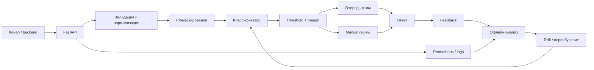

# Архитектура системы

**Статус:** draft, заполняется на этапе 2  
**Источник требований:** [`TZ.md`](TZ.md), §7–§8; вебинары В01–В04

## 1. Контекст

Пользователь отправляет обращение в поддержку музыкального сервиса. Backend передаёт текст в сервис классификации и получает тему, confidence, top-k, очередь и флаг ручной проверки. Сервис не отвечает пользователю сам — он только маршрутизирует тикет.

## 2. Ключевые решения

| Вопрос | Решение | Причина |
|---|---|---|
| Монолит или микросервисы | Модульный монолит / один FastAPI-сервис | 5 человек, одна модель, учебная нагрузка |
| Batch или stream | Online-обработка нового тикета; batch-эндпоинт опционально | Нужен ответ при создании обращения |
| Паттерн интеграции | Embedded model в процессе API | Простота, скорость, без сетевой задержки |
| Classical ML или LLM | Classical ML (TF-IDF + LogReg, optional transformer) | Цена, задержка, приватность, детерминизм |
| Human-in-the-loop | Да, при низкой уверенности/margin | Снижение цены ошибки |
| Feature store | Не используем | Одна модель, простые признаки |

## 3. Компоненты

| Компонент | Ответственность |
|---|---|
| Канал / backend | Источник тикета |
| FastAPI API | Валидация, версия, ошибки |
| Preprocessing | Нормализация, очистка, PII |
| Classifier | Вероятности по 7 классам |
| Routing | threshold, margin, очередь, review |
| Feedback | Подтверждение/исправление оператора |
| Monitoring | Метрики, логи, алерты |
| MLflow | Эксперименты и артефакты |

## 4. Схема

## 5. Поток запроса

1. `POST /v1/classify`.
2. Pydantic-валидация.
3. Нормализация текста.
4. PII-маскирование.
5. Инференс.
6. Routing.
7. Ответ + метрики + лог.
8. Feedback (опционально).

## 6. Три узких места

| Узкое место | Последствие отказа | Митигация |
|---|---|---|
| Артефакт модели не загрузился | 503, маршрутизация остановлена | checksum, readiness, rollback, manual queue |
| Backend/очередь недоступна | Тикет не попал в очередь | retry, очередь сообщений, manual fallback |
| Drift входных данных | Тихие ошибки, падение качества | мониторинг, drift-отчёт, переобучение |

## 7. Контракт

См. [`api.md`](api.md). Обязательные элементы: вход, выход, SLA, ошибки, версия API/модели/данных, OpenAPI.

## 8. ADR

| ID | Решение | Статус |
|---|---|---|
| ADR-01 | Модульный монолит | accepted |
| ADR-02 | Online-обработка | accepted |
| ADR-03 | Embedded model | accepted |
| ADR-04 | Classical ML без LLM в инференсе | accepted |
| ADR-05 | 7 классов | proposed |
| ADR-06 | Human-in-the-loop | accepted |
| ADR-07 | MLflow локально | accepted |
| ADR-08 | Без GitHub CI/CD | accepted |
| ADR-09 | Без feature store | accepted |

## 9. Что добавить

- [ ] Схема в draw.io/Mermaid с подписями.
- [ ] SLA и поведение при ошибках.
- [ ] Версионирование API/модели/данных.
- [ ] Три узких места с последствиями.
- [ ] Production-маршрут: reverse proxy, replicas, registry, queue, DB, secrets.
- [ ] Связь с 7 этапами ЖЦ.
