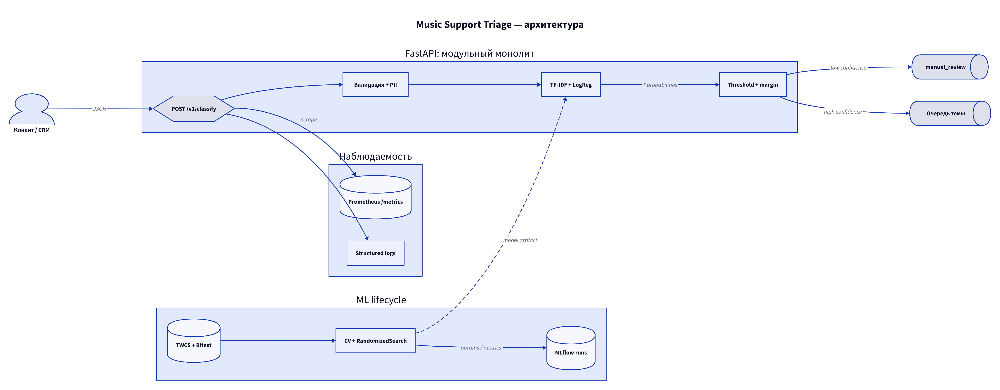

# Итоговый отчёт: Music Support Triage

**Версия:** черновик 0.3, 14.11.2026  
**Команда:** Максим Федулаев, Владимир Егоров, Айдар Мугизов, Евгений Кононов, Александр Аксенов  
**Репозиторий:** https://github.com/NexPG/final-project-IAIiD  
**Data card:** [`data_card.md`](data_card.md) · **Model card:** [`model_card.md`](model_card.md)

> **Статус чисел.** Метрики получены на **weak labels** и являются предварительными. После human-verified разметки test (400) таблица обновляется без изменения архитектуры и кода. Все числа воспроизводятся командами из раздела 12.

## 1. Задача и бизнес-контекст

Музыкальный стриминговый сервис получает обращения в поддержку через приложение, сайт, e-mail, чат и Twitter. Первая линия вручную сортирует их по темам, из-за чего растёт время ответа, а часть тикетов попадает не в ту очередь.

Цель — по тексту обращения определить одну из семи тем и предложить очередь. При низкой уверенности обращение уходит на ручную проверку, а не в случайную очередь.

| Класс | Очередь | Пример |
|---|---|---|
| `payment` | `billing` | «Списали дважды», «Где чек?» |
| `subscription` | `subscriptions` | «Отключите автопродление» |
| `account` | `account_support` | «Не приходит код входа» |
| `app` | `technical_support` | «Трек зависает на 10 секунде» |
| `recommendations` | `recommendations` | «Почему мне советуют это?» |
| `content` | `content_support` | «Пропал альбом» |
| `other` | `general_support` | «Хочу предложить сотрудничество» |

**Метрики успеха:** CV macro-F1, test macro-F1 с 95% bootstrap CI, recall каждого класса, selective precision ≥ 0.95, coverage ≥ 0.40, p95 latency ≤ 300 мс.

**Границы:** учебный прототип; нет реальной CRM, автоматических ответов и круглосуточной эксплуатации.

## 2. Этапы проекта и их логика

Этапы взяты из слайда 3 проектного плана. Каждый этап передаёт следующему конкретный артефакт.

| Этап | Вход | Что делаем | Выход |
|---|---|---|---|
| 1. Задача | Требования курса | Таксономия, метрики, границы, данные | `TZ.md`, `README.md`, `data.md` |
| 2. Архитектура | TZ, 7 классов | Монолит, API, routing, 3 узких места | `architecture.md`, `api.md`, код API |
| 3. Эксперименты | Данные + архитектура | CV, RandomizedSearchCV, выбор модели, CI | `experiments.md`, MLflow, `model_card.md` |
| 4. Тестирование | Модель + API | Data/model/API/contract/load tests | `tests/`, `testing.md` |
| 5. Деплой | Протестированный сервис | Docker, Compose, smoke, rollback | `deployment.md`, Docker-стек |
| 6. Мониторинг | Работающий сервис | Метрики, алерты, drift, runbook | `monitoring.md`, alert rules |

## 3. Архитектура

Выбран **модульный монолит** на FastAPI с моделью в процессе API. Схема — [`architecture.png`](architecture.png), исходная Mermaid-версия — в [`architecture.md`](architecture.md).



```text
Client / CRM
    │ POST /v1/classify
    ▼
FastAPI ── validation ── PII masking ── TF-IDF + LogReg ── routing
    │                                              │
    │                                              ├─ queue (auto)
    │                                              └─ manual_review
    ▼
structured logs + Prometheus /metrics
```

**Почему монолит:** команда 5 человек, один потребитель, небольшая нагрузка. **Почему online:** ответ нужен в момент обращения. **Почему classical ML:** TF-IDF + LogReg быстро обучается на CPU, интерпретируем и достаточен для 7 классов; LLM/agent — overengineering.

**Три узких места:**

1. Модель не загрузилась → все запросы 503; readiness, checksum, rollback, manual fallback.
2. Очередь/CRM недоступна → тикет не маршрутизируется; retry и manual queue.
3. Drift входных данных → тихие ошибки; мониторинг, drift-отчёт, переобучение.

**API:** `POST /v1/classify`, `POST /v1/classify/batch`, `POST /v1/feedback`, `GET /healthcheck`, `GET /model-info`, `GET /metrics`. Ответ содержит `request_id`, тему, очередь, confidence, margin, top-3, `needs_human_review` и версию модели.

## 4. Технологический стек

| Компонент | Выбор | Причина |
|---|---|---|
| Язык | Python 3.12 | ML/NLP-экосистема |
| API | FastAPI + Pydantic v2 | OpenAPI, валидация, TestClient |
| Модель | TF-IDF + LogisticRegression | CPU, скорость, интерпретируемость |
| Подбор | RandomizedSearchCV + StratifiedGroupKFold | Быстрее полного grid, честная CV |
| Данные | pandas + PyYAML | Воспроизводимый pipeline |
| Трекинг | MLflow (SQLite) | Runs, params, metrics, artifacts |
| Валидация | Great Expectations | 8 expectations, отчёт |
| Тесты | pytest + httpx | Unit/integration/model |
| Деплой | Docker + Compose | Воспроизводимость |
| Мониторинг | Prometheus + alert rules | Стандарт, демонстративно |

## 5. Данные

| Источник | Объём | Роль |
|---|---|---|
| TWCS SpotifyCares | 6 000 в dev-подкорпусе, ~38 тыс. всего | Реальный домен |
| Bitext Customer Support | 26 872, сэмпл 8 000 | Вспомогательный train |
| 420 синтетических | 420 | Seed (пока не подключены) |

Домен TWCS делится **80/20**: train 80%, frozen test 20%. Bitext добавлен только в train, поэтому в test его нет.

Итог: **train 11 004**, **test 1 163**, всего 12 167. Train — TWCS 3 725 + Bitext 7 279. `other` в train ограничен 35%.

### 5.1. Почему train + CV + test, а не train/validation/test

Отдельный validation не нужен, если есть корректная CV:

- **80% домена** — train: единственный источник для обучения, выбора семейства, гиперпараметров и порога;
- **StratifiedGroupKFold(5)** на train даёт out-of-fold оценки, сохраняя целые `conversation_id` в одном фолде;
- **RandomizedSearchCV** перебирает гиперпараметры по CV;
- порог и margin выбираются по OOF-предсказаниям train;
- **20% домена** — frozen test: открывается один раз после фиксации модели и порога;
- Bitext — вспомогательный источник, только train, чтобы не подменять реальный домен в test.

Это честнее, чем отдельный validation: больше данных для CV, нет соблазна подбирать модель по test, а стоимость ошибки оценивается на независимой выборке.

## 6. Эксперименты

### 6.1. Схема

- 5-fold `StratifiedGroupKFold`, `groups=conversation_id`, scoring=`f1_macro`;
- `RandomizedSearchCV`, `n_iter=12` на каждое семейство;
- 4 семейства: LogisticRegression word, LogisticRegression word+char, calibrated LinearSVC, ComplementNB;
- выбор по mean CV macro-F1; test не используется;
- после выбора: refit на полном train, OOF-порог, **одно** измерение на test;
- 95% bootstrap CI (1000 ресэмплов) для test macro-F1.

### 6.2. Результаты CV

| Семейство | CV macro-F1 | Std |
|---|---|---|
| **logreg_word** | **0.875** | **0.025** |
| logreg_word_char | 0.862 | 0.035 |
| linear_svc (calibrated) | 0.816 | 0.022 |
| complement_nb | 0.704 | 0.011 |

Выбрано **logreg_word**: TF-IDF word (1–2), `min_df=2`, `max_features=100000`, `sublinear_tf=True`, C=32, `class_weight=balanced`.

### 6.3. Финальный test (один раз)

| Метрика | Значение |
|---|---|
| Accuracy | 0.917 |
| Macro-F1 | **0.726** |
| Weighted-F1 | 0.916 |
| Bootstrap 95% CI для macro-F1 | **[0.645; 0.797]** |
| Balanced test macro-F1 | 0.760 |

Per-class recall: `payment` 0.75, `subscription` 0.87, `account` 0.69, `app` 0.82, `recommendations` 0.45, `content` 0.40, `other` 0.96.

**Вывод:** частые классы устойчивы, macro-F1 ограничен редкими классами. `recommendations` имеет 11 тестовых примеров, `content` — 5; их per-class вывод остаётся широким, но 20% test даёт более устойчивую общую оценку. Цель 0.80 **не достигнута** (0.726); причины — weak labels, редкие классы и domain shift. Это честно фиксируется, а не маскируется.

### 6.4. Threshold и routing

Порог выбран по OOF-предсказаниям train с политикой «оставить минимум 10% на manual review»:

| Параметр | Значение |
|---|---|
| Threshold / margin | 0.85 / 0.05 |
| OOF coverage | 0.887 |
| OOF selective precision | 0.989 |
| Test coverage | 0.742 |
| Test selective precision | **0.979** |
| Test review rate | 0.258 |

Selective precision 0.979 ≥ 0.95 и coverage 0.742 ≥ 0.40 — целевые показатели выполнены. OOF и test отличаются из-за distribution shift, поэтому в production порог пересматривается на human-verified данных.

## 7. Данные, валидация и тестирование

**Pipeline:** download → clean → PII masking → dedup → weak labeling → mapping → group split → manifest → validation.

**Проверки:** обязательные поля, классы/split/source, длины 10–5000, уникальность id, cross-split дубли, утечка `conversation_id`, `other` ≤ 40%, синтетика ≤ 15%, human-verified в eval, PII. Отчёт — `data/processed/validation_report.json`. Great Expectations — **8/8** expectations на 12 167 строках.

**Тесты:** **37 passed**. Покрыты очистка/PII, маппинг, group split, cap `other`, дедупликация, data validation, routing, API, batch, feedback idempotency, `/metrics`, model quality (overall, per-class, robustness, edge, behavior, adversarial, subgroup). Локальный quality gate: `ruff`, `mypy`, `pytest`, smoke.

**Найденная проблема:** отрицание «I don't want to cancel my subscription, I need a receipt» → `subscription`, confidence 0.647, manual_review. Это одновременно баг качества и корректное безопасное поведение routing. Дополнительно: `content` ↔ `recommendations` confusion.

## 8. Деплой

- Multi-stage `docker/Dockerfile`, slim, non-root, healthcheck.
- `docker/docker-compose.yml`: API + Prometheus, `API_PORT` параметризован.
- Модель и конфиги монтируются read-only.
- Smoke `scripts/smoke.py`: healthcheck, model-info, classify, batch, metrics — **5/5** на uvicorn и в Docker.
- `docker compose build` и `up -d --wait` проверены: api и Prometheus healthy.
- Rollback: предыдущий `model.joblib` + перезапуск; артефакт не коммитится.
- CI/CD на GitHub не используется: локальный quality gate и ручной release.

## 9. Мониторинг

**Инфраструктура:** `up`, 5xx rate, p95 latency, CPU/RAM.
**Продукт:** запросы, auto-routed share, manual share, distribution тем.
**Модель:** `model_loaded`, inference latency, confidence, drift.

Метрики — `/metrics`; Prometheus scrape и 4 алерта: `TriageApiDown`, `TriageModelNotReady`, `TriageHigh5xxRate`, `TriageHighLatency`. Алерт проверен: после `docker compose stop api` `TriageApiDown` перешёл в **firing**, после запуска smoke снова 5/5.

**Drift:** `scripts/drift_report.py`: PSI длины **0.883**, KS **0.404**, p < 0.001; `other_share` 34.7% в train против 73.2% в test. Причина — cap `other` и естественное распределение test. Это ожидаемый shift, но он требует production-мониторинга `other_share` и длины.

## 10. ИИ-ассистенты

Использовались для: аудита TZ, исследования датасетов, каркаса pipeline, API, тестов, Docker, MLflow/GE, черновика отчёта. Проверено вручную: все команды запущены, тесты и линтеры пройдены, метрики пересчитаны, ссылки сверены. Не делегировалось: таксономия, разметка, выводы экспериментов, этика и защита. Журнал — `docs/ai_usage.md`.

## 11. Ограничения, drift и этика

- Test пока weak; финальные выводы требуют human-verified разметки.
- TWCS — публичные твиты с шумом, сарказмом, ссылками и PII; PII маскируется, сырые данные не коммитятся.
- Bitext — другой домен (retail/support); вес ниже, оценка только на TWCS.
- `content` и `recommendations` редки; без human-written кейсов их recall ненадёжен.
- Модель не понимает отрицания и сложные multi-topic обращения; такие случаи уходят в manual.
- Distribution shift train/test: `other_share` 34.7% vs 73.2%, PSI длины 0.883.
- Automation bias: интерфейс должен показывать confidence и top-3.
- Лицензия TWCS требует уточнения; данные используются локально в учебных целях.

## 12. Воспроизводимость

```bash
python scripts/download_data.py --config configs/data.yaml
python scripts/build_dataset.py --config configs/data.yaml
python scripts/validate_data.py --config configs/data.yaml
python scripts/validate_data_ge.py
python scripts/search_models.py --n-iter 12
python scripts/tune_threshold.py
python scripts/evaluate.py --split test --balanced --data data/processed/test_balanced.csv
python scripts/drift_report.py
uvicorn music_support_triage.api.app:app --port 8000
python scripts/smoke.py
```

**Следующий шаг (Gate 3):** стратифицированные 400 примеров из 20% test уже выгружены в `data/annotation/batch_test_a.csv` и `batch_test_b.csv` (поддержка: payment 25, subscription 47, account 25, app 25, recommendations 11, content 5, other 262). После заполнения двумя разметчиками: `merge_annotations.py` → `check_gate3.py`; скрипт проверит kappa ≥ 0.70, отсутствие утечек и пересчитает метрики + CI без weak labels.

## 13. Роли

| Участник | Этап | Вклад |
|---|---|---|
| Максим Федулаев | 2. Архитектура | Схема, API-контракт, ADR |
| Владимир Егоров | 3. Эксперименты | Данные, CV, RandomizedSearchCV, модель, CI |
| Айдар Мугизов | 4. Тестирование | Тест-план, pytest, data validation |
| Евгений Кононов | 5. Деплой | Docker, Compose, smoke, rollback |
| Александр Аксенов | 6. Мониторинг | Метрики, алерты, drift, отчёт |
| Вся команда | 1. Задача | TZ, таксономия, данные, защита |
